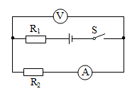

# Physics - 题目 51

**ID**: 2ea499eb2e2e44219092ec12e9283ea4
**年级**: Grade 9
**难度**: Medium-Hard
**题型**: Short Answer

## 题目
在图所示的电路中，电阻R_{1}、R_{2}的阻值相等，开关S闭合后，电路正常工作，电流表和电压表的示数分别为I_{0}和U_{0}。​​​​​​​‌一段时间后，观察到其中一个电表示数突然变大，已知电路中仅有一处故障，且只发生在电阻R_{1}、R_{2}上，请根据以上信息写出两电表示数及相对应的故障。

## 解答

1. 如图，R_{1}R_{2}串联，电压表测R_{2}两端电压，电流表测电路中电流。因为电阻R_{1}、R_{2}的阻值相等，电流表和电压表的示数分别为I_{0}和U_{0}，即R_{2}两端电压为U_{0}，同时R_{1}两端电压为U_{0}，电源电压为2U_{0}。一段时间后，观察到其中一个电表示数突然变大，已知电路中仅有一处故障，且只发生在电阻R_{1}、R_{2}上。
2. 若R_{1}断路，电压表、电流表示数均为0，不符合题意；若R_{2}断路，电压表测电源电压，变大至2U_{0}，电流表示数为0，符合题意；若R_{1}短路，电压表测电源电压，变大至2U_{0}，电路中总电阻减小为原来的一半，电流表示数变大至2I_{0}，不符合题意；若R_{2}短路，电压表并联在导线两端，示数为0，电路中总电阻减小为原来的一半，电流表示数变大至2I_{0}，符合题意。
3. 综上：若电压表示数为2U_{0}，电流表示数为0，则电阻R_{2}断路；若电压表示数为0，电流表示数为2I_{0}，则电阻R_{2}短路。

## 知识点

**中文**:
  - 应用欧姆定律进行电路故障分析
  - 电流表、电压表在判断电路故障中的应用

**English**:
  - Circuit Fault Analysis using Ohm's Law
  - Using Meters to Diagnose Circuit Faults

---
