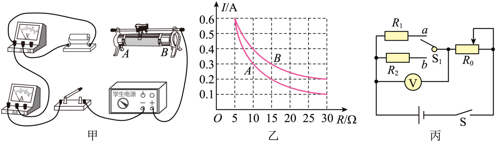

# Physics - 题目 2058

**ID**: af6105946de54414aa79e23c32e34c03
**年级**: Grade 9
**难度**: Medium-Hard
**题型**: 未知

## 题目
八中物理实验社的同学探究电流与电阻的关系，已知电源电压恒为5V，电流表量程为0~0.6A，电压表量程为0~3V。​​​​​​​‌实验中用到的定值电阻有5Ω、10Ω、15Ω、25Ω、30Ω各1个。连接的实验电路如图所示。（1）请在图甲中连接一根导线完成电路，使滑片左移时，两电表示数均变大；（2）闭合开关前，应将滑片置于端（选填“A”或“B”）；实验过程中需要更换不同阻值的定值电阻重复操作，目的是；（填序号，A：“减小误差”或B：“寻找普遍规律”）（3）同组的A、B两同学换用不同电阻进行实验（电压表量程可能进行了更换），根据各自的实验数据作出了如图乙所示的I-R图像，其中同学的图像是错误的。分析图像，你认为错误同学在操作中的问题是：；（4）实验中若将5Ω的电阻接入电路时，电压表示数为U_{1}，更换为25Ω的电阻后，立即闭合开关，电压表示数为U_{2}，则U_{2}5U_{1}（选填“>”“<”或“=”）；（5）根据图乙中正确同学的图像，保持电路连接不变，关于此实验的分析，下列说法正确的是；

## 解答

1. （1）要使滑片左移时，两电表示数均变大，即只需电路中电流变大，滑动变阻器接入电路的电阻应变小，所以应将滑动变阻器左下接线柱与定值电阻左接线柱相连。如下图所示：
2. 
3. （2）连接电路时，为了保护电路，滑动变阻器的滑片应处于阻值最大处，滑片应处于B端。
4. 实验过程中更换不同阻值的定值电阻重复操作，是为了得出不同电阻时，通过电阻的电流大小，从而归纳总结出电流与电阻的关系的普遍规律。
5. （3）如图所示，根据 $U=IR$ 可得，当电阻5Ω、10Ω、15Ω、30Ω时：A同学实验时，各电阻两端的电压分别为 $U{{}_{{\rm{A}}5}}=I{{}_{{\rm{A}}5}}R{{}_{{\rm{A}}5}}=0.6{\rm{A}}\times 5Ω=3{\rm{V}}$ ，同理可得 $U{{}_{{\rm{A}}{{1}}{{0}}}}=U{{}_{{\rm{A}}{{1}}{{5}}}}=U{{}_{{\rm{A}}{{3}}{{0}}}}=3{\rm{V}}$ ，同理可得B同学实验时，各电阻两端的电压分别为 $U{{}_{{\rm{B}}{{5}}}}=3{\rm{V}}$ 、 $U{{}_{{\rm{B}}{{1}}{{0}}}}=4{\rm{V}}$ 、 $U{{}_{{\rm{B}}{{1}}{{5}}}}=4.5{\rm{V}}$ 、 $U{{}_{{\rm{B}}{{3}}{{0}}}}=6{\rm{V}}{\rm ，B}$ 同学实验时，没有保持电阻两端电压不变，不符合控制变量法的使用方法，B同学的图像错误。
6. （4）当电阻为5Ω时，有 $U{{}_{1}}=I{{}_{1}}R{{}_{1}}$ ，当换为25Ω的电阻后，有 $U{{}_{2}}=I{{}_{2}}R{{}_{2}}=5I{{}_{2}}R{{}_{1}}$ ，因为将5Ω的电阻更换为25Ω的电阻后，不移动滑片时，电路中总电阻变大，电流变小，即 $I{{}_{2}}<I{{}_{1}}$ ，则 $U{{}_{2}}=5I{{}_{2}}R{{}_{1}}<5I{{}_{1}}R{{}_{1}}=5U{{}_{1}}$ ， $U{{}_{2}}<5U{{}_{1}}$ 。
7. （5）A．实验中滑动变阻器的作用是控制定值电阻两端电压不变，A错误；
8. B．由图乙可知，当定值电阻最大为30Ω时，电流最小为0.1A，此时滑动变阻器阻值最大，最大电阻 $R{{}_{滑大}}=\frac {U-U{{}_{{\rm{R}}}}}{I{{}_{最小}}}=\frac {5{\rm{V}}-3{\rm{V}}}{0.1{\rm{A}}}=20\Omega $ ，当定值电阻最小为5Ω时，电流最大为0.6A，此时滑动变阻器阻值最小，最小电阻 $R{{}_{滑小}}=\frac {U-U{{}_{{\rm{R}}}}}{I{{}_{最大}}}=\frac {5{\rm{V}}-3{\rm{V}}}{0.6{\rm{A}}}=\frac {10}{3}\Omega $ ，则最大和最小阻值之比 $\frac {R{{}_{滑大}}}{R{{}_{滑小}}}=\frac {20Ω}{\frac {10}{3}Ω}=\frac {6}{1}{\rm ，B}$ 正确；
9. C．当定值电阻为30Ω时，滑动变阻器接入电路的电阻最大，即接入电路中的最大电阻为20Ω，“20Ω0.8A”规格的滑动变阻器符合要求，C正确；
10. D．若接入滑动变阻器规格为“30Ω1A”，当滑动变阻器阻值最大时，定值电阻两端电压最小，根据串联分压可知，有 $\frac {U}{U{{}_{最小}}}=\frac {R+R{{}_{滑动}}}{R}$ ，即 $\frac {5{\rm{V}}}{U{{}_{最小}}}=\frac {R+30\Omega }{R}$ ，则当R的阻值最大时，定值电阻两端电压最小，即 $R=30Ω$ 时，定值电阻两端电压最小，代入解得 $U{{}_{最小}}=2.5{\rm{V}}$ ，因为保持电路连接不变，则电压表的量程也为0~3V也不变，定值电阻两端电压可以调节的范围为2.5~3V，D正确。
11. （6）当S_{1}接a时，R_{1}与R_{0}串联，假设此时滑动变阻器接入电路的电阻为R_{0a}，此时R_{1}两端电压 $U{{}_{1}}=4{\rm{V}}$ ，则R_{0a}两端电压 $U{{}_{{\rm{a}}}}=U{^{^{′}}}-U{{}_{1}}=9{\rm{V}}-4{\rm{V}}={{5}}{\rm{V}}$ ，根据串联分压可知 $\frac {U{{}_{1}}}{U{{}_{{\rm{a}}}}}=\frac {R{{}_{1}}}{R{{}_{0{\rm{a}}}}}=\frac {4}{5}$ ，则 $R{{}_{0{\rm{a}}}}=\frac {5R{{}_{1}}}{4}$ ，当S_{1}接b时，R_{2}与R_{0}串联，假设此时滑动变阻器接入电路的电阻为R_{0b}，此时R_{2}两端电压 $U{{}_{2}}=4{\rm{V}}$ ，则R_{0b}两端电压 $U{{}_{{\rm{b}}}}=U{^{^{′}}}-U{{}_{2}}=9{\rm{V}}-4{\rm{V}}={{5}}{\rm{V}}$ ，根据串联分压可知 $\frac {U{{}_{2}}}{U{{}_{{\rm{b}}}}}=\frac {R{{}_{2}}}{R{{}_{0{\rm{b}}}}}=\frac {4}{5}$ ，则 $R{{}_{0{\rm{b}}}}=\frac {5R{{}_{2}}}{4}$ ，则两次滑动变阻器连入电路中的阻值之差 ${\rm{Δ}}R=R{{}_{0{\rm{a}}}}-R{{}_{0{\rm{b}}}}=\frac {5R{{}_{1}}}{4}-\frac {5R{{}_{2}}}{4}=\frac {5}{4}\left ({R{{}_{1}}-R{{}_{2}}}\right )=\frac {5}{4}\times 4{\rm{Ω}}=5{\rm{Ω}}$ 。

## 知识点

**中文**:
  - 电流与电阻关系的探究实验

**English**:
  - Experiment: Relationship between Current and Resistance

---
