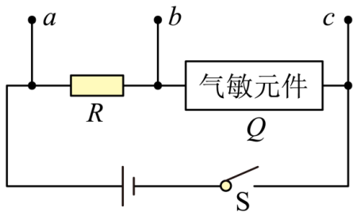

# Physics - 题目 803

**ID**: 01cccfa49cbd4eddb9e17346ac37ef5f
**年级**: Grade 9
**难度**: Medium
**题型**: Multiple-choice

## 题目
如图是某简易煤气检测电路，其中Q为气敏元件，其阻值随煤气浓度的升高而减小。​​​​​​​‌若输出信号的仪表选用电压表或电流表，闭合开关S，当煤气浓度升高时，要求仪表的示数增大，则 $($ 　　 $)$

## 解答

1. 由图示知，若在 $ab$ 或 $bc$ 间连接电流表，则电路中的电阻 $R$ 或气敏元件Q会被短路，所以仪表应选用电压表。由题意可知，当煤气浓度升高时，气敏元件Q的阻值减小，电路的总电阻变小，由 $I=\frac {U}{R}$ 可知，电路中的电流增大，电阻 $R$ 两端的电压变大，因串联电路中总电压等于各部分电压之和，所以，气敏电阻Q两端的电压减小，按要求，仪表的示数增大，说明电压表接在 $ab$ 间，故A正确，符合题意，BCD不正确，不符合题意。

## 知识点

**中文**:
  - 欧姆定律的应用
  - 电路的动态分析

**English**:
  - Applications of Ohm's Law
  - Dynamic Circuit Analysis

---
