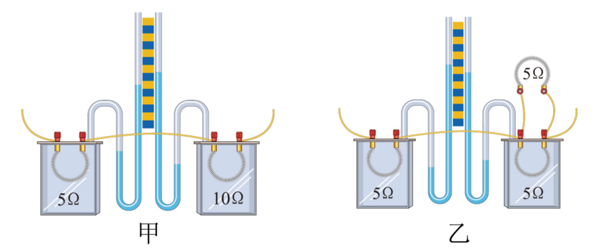

# Physics - 题目 2683

**ID**: 0259ed0719e74cceb15bde6e00ca5d02
**年级**: Grade 9
**难度**: Medium
**题型**: Multiple-choice

## 题目
如图所示是探究电流通过导体时产生热量的多少跟什么因素有关的实验装置，两个透明容器中密封着等量的空气，U形管中液面高度的变化反映密闭空气温度的变化，下列说法正确的是（      ）​​​​​​​‌

## 解答

1. A．乙图实验装置中两个5Ω的电阻并联后再与一个5Ω的电阻串联，根据串联电路的电流特点可知，右边两个电阻的总电流和左边电阻的电流相等，即 $I{{}_{右}}＝I{{}_{左}}$ ，两个5Ω的电阻并联，根据并联电路的电流特点知 $I{{}_{右}}＝I{{}_{1}}+I{{}_{2}}$ ，两电阻的阻值相等，则支路中电流相等，即 $I{{}_{1}}＝I{{}_{2}}$ ，所以右边容器中通过电阻的电流是左侧通过电流的一半，左右两测容器内电阻相同，所以该装置是研究电流产生的热量与电流的关系，故A正确；
2. B．甲图实验装置中两个电阻串联接入电路，通过两电阻的电流相等，右边容器内的电阻比左边大，由 $Q＝I{^{2}}Rt$ ，可知，右边容器中的电阻产生的热量多，温度升得较快；因此通电一段时间后，右侧U形管中液面的高度差更大，故B错误；
3. C．该实验装置是利用U形管中空气的热胀冷缩来反应热的多少，虽然产生热量的多少不能直接观察，但可以通过U形管液面高度差的变化来反映，故C错误；
4. D．乙图右侧密闭容器中的5Ω的电阻换成10Ω后，两容器内的电阻不同，通过两电阻的电流也不相等，无法控制变量，故D错误。

## 知识点

**中文**:
  - 影响电流热效应因素的探究实验

**English**:
  - Experiment: Factors Affecting Heating Effect

---
