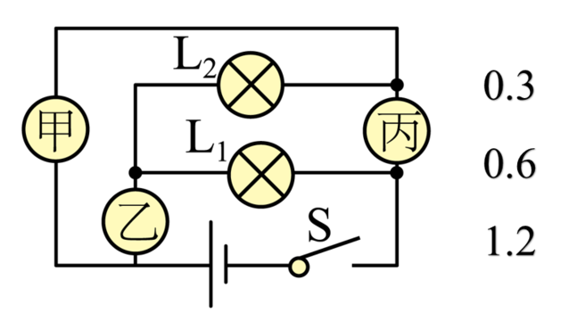

# Physics - 题目 1673

**ID**: 0823d3c78e4e489cbdb457557bba17b0
**年级**: Grade 9
**难度**: Medium
**题型**: Multiple-choice

## 题目
在如图所示电路中，开关 ${\rm{S}}$ 闭合时，规格相同的灯泡 ${\rm{L}}{{}_{1}}$ 、 ${\rm{L}}{{}_{2}}$ 均能发光，图中甲、乙、丙为电表，粗心的小明在读数时只在纸上记录了如图所示数字，则下列说法中正确的是（      ）​​​​​​​‌

## 解答

1. 规格相同的灯泡L_{1}、L_{2}均能发光时，它们的连接方式可以是串联或并联。
2. AB．若两灯泡并联时，则电路中电流有两条路径，电流从电源的正极出发，经乙电表后分支，一支经灯泡L_{1}回到电源的负极，一支经灯泡L_{2}、丙电表回到电源的负极，则甲为电压表测电源的电压，乙为电流表测干路电流，丙为电流表测L_{2}支路的电流，由于并联电路中各支路两端的电压相等，且干路电流等于各支路电流之和，所以由 $I=\frac {U}{R}$ 知道，通过两灯泡的电流相等，干路电流是L_{2}支路电流的两倍，由图中数据知道，乙的示数为1.2A，丙的示数为0.6A，则甲的示数为0.3V，乙的示数为0.6A，丙的示数为0.3A，则甲的示数为1.2V，通过L_{1}、L_{2}的电流均为0.3A。故AB错误；
3. CD．若两灯泡串联时，则电路中的电流只有一条路径，电流从电源的正极出发，依次经甲电表、灯泡L_{2}、灯泡L_{1}回到电源的负极，则甲为电流表测电路中的电流，乙为电压表测L_{2}两端的电压，丙为电压表测电源的电压，因为串联电路中各处的电流相等，且两灯泡规格相同时它们两端的电压相等，所以由 $I=\frac {U}{R}$ 知道，电源的电压是L_{2}两端电压的2倍，即丙的示数是乙示数2倍，由图中数据知道，丙的示数为1.2V，乙的示数为0.6V，则甲的示数为0.3A，丙的示数为0.6V，乙的示数为0.3V，则甲的示数为1.2A，L_{1}、L_{2}两端的电压均为0.3V，故C错误，D正确。

## 知识点

**中文**:
  - 串联电路和并联电路的辨别
  - 电流表的使用
  - 并联电路的电流规律
  - 电压表的使用
  - 串联电路的电压规律

**English**:
  - Distinguishing Series and Parallel Circuits
  - Using an Ammeter
  - Current Law in Parallel Circuits
  - Using a Voltmeter
  - Voltage Law in Series Circuits

---
