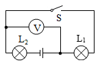

# Physics - 题目 1470

**ID**: 0b59218c67a347a48b6363dcf9272111
**年级**: Grade 9
**难度**: Medium
**题型**: Multiple-choice

## 题目
如图所示，电源电压为5V，闭合开关S，电压表的示数为1V。​​​​​​​‌下列说法正确的是（      ）①通过灯泡L_{1}的电流比L_{2}的电流大②灯泡L_{1}两端的电压是1V③灯泡L_{1}和L_{2}的电阻之比是1∶4④若断开开关S，电压表示数为0V

## 解答

1. 由电路图可知，闭合开关 ${\rm S，}{\rm{L}}{{}_{{{1}}}}$ 与 ${\rm{L}}{{}_{{{2}}}}$ 串联，电压表测 ${\rm{L}}{{}_{{{1}}}}$ 两端的电压。
2. ①因串联电路中各处的电流相等，所以通过灯泡 ${\rm{L}}{{}_{{{1}}}}$ 的电流和 ${\rm{L}}{{}_{{{2}}}}$ 的电流相等，①错误；
3. ②由电压表的示数可知，灯泡 ${\rm{L}}{{}_{{{1}}}}$ 两端的电压是 ${{1}}{\rm{V}}$ ，②正确；
4. ③因串联电路中总电压等于各分电压之和，所以灯泡 ${\rm{L}}{{}_{{{2}}}}$ 两端的电压 $U{{}_{2}}=U-U{{}_{1}}=5{\rm{V}}-{{1}}{\rm{V}}{\rm{=}}{{4}}{\rm{V}}$ ，由 $I=\frac {U}{R}$ 可知，灯泡 ${\rm{L}}{{}_{{{1}}}}$ 和 ${\rm{L}}{{}_{{{2}}}}$ 的电阻之比 $\frac {R{{}_{1}}}{R{{}_{2}}}=\frac {\frac {U{{}_{1}}}{I}}{\frac {U{{}_{2}}}{I}}=\frac {U{{}_{1}}}{U{{}_{2}}}=\frac {{{1}}{\rm{V}}}{{{4}}{\rm{V}}}=\frac {1}{4}$ ，③正确；
5. ④若断开开关S，电压表串联在电路中测电源两端的电压，其示数为5V，④错误；
6. 综上可知，只有②③正确。

## 知识点

**中文**:
  - 串联电路的电压规律
  - 串联电路的电流规律
  - 欧姆定律的应用

**English**:
  - Voltage Law in Series Circuits
  - Current Law in Series Circuits
  - Applications of Ohm's Law

---
