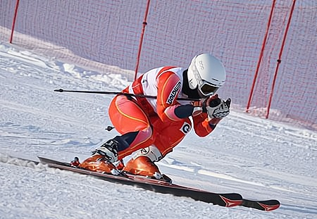

# Physics - 题目 2583

**ID**: 0bb510733bf44408b3e813ed04982877
**年级**: Grade 9
**难度**: Medium
**题型**: Multiple-choice

## 题目
2025年2月11日，哈尔滨亚冬会自由式滑雪女子坡面障碍技巧决赛，中国选手刘梦婷夺得金牌。​​​​​​​‌如图所示是滑雪运动员从山上滑下的情景，下列说法正确的是（      ）

## 解答

1. A．运动员弯着腰是通过降低重心来增大温稳度，不是增大力，故A错误；
2. B．停止撑地，运动员会慢慢停下来，是因为运动员受到雪地对运动员的摩擦力作用，说明力是改变物体运动状态的原因，不是维持物体运动的原因，故B错误；
3. C．压力一定时，接触面越粗糙，摩擦力越大，运动员手套掌心部分比较粗糙，目的是增大摩擦，故C错误；
4. D．运动员加速下滑过程中，运动员质量不变，速度增大，动能增大，故D正确。

## 知识点

**中文**:
  - 力与运动的关系
  - 重心
  - 增大或减小摩擦的方法
  - 动能的变化问题

**English**:
  - Relationship between Force and Motion
  - Center of Gravity
  - Methods to Increase or Decrease Friction
  - Changes in Kinetic Energy

---
