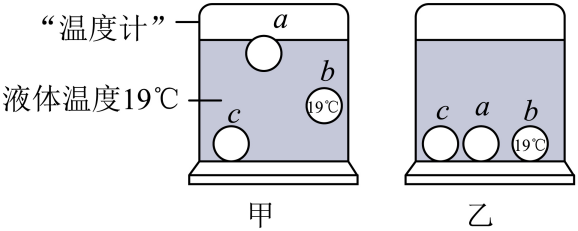

# Physics - 题目 2661

**ID**: 1127b96242674d2fbdfc922ff9195374
**年级**: Grade 9
**难度**: Medium
**题型**: Multiple-choice

## 题目
小明自制的“温度计”中有密度随温度升高而变小的液体。​​​​​​​‌如图甲，当该液体温度为19℃时，质量为 $4\times 10{^{-3}}{\rm{k}}{\rm{g}}$ 的小球b悬浮，b标记“19℃”；另外两个小球分别标记“15℃”“23℃”，当小球悬浮时，它标记的温度与液体温度相等。图甲中小球a漂浮、小球b悬浮、小球c沉底，忽略小球体积变化，g取 $10{\rm{N}}/{\rm{k}}{\rm{g}}$ 。图乙中小球a、b、c均沉底，则下列说法正确的是（      ）

## 解答

1. A．图甲中b悬浮，浮力等于重力，图乙中b沉底，则浮力小于重力，重力不变，则图乙中b所受浮力小于图甲中b所受浮力，故A错误；
2. B．图乙中b沉底，则小球b的密度大于液体的密度。因为液体密度随温度升高而变小，b标记“19℃”，所以图乙中液体温度大于19℃，故B正确；
3. CD．甲中小球c沉底，小球a漂浮，而液体密度随温度升高而变小，所以小球c对应标记“15℃”，小球a对应标记“23℃”，故CD错误。

## 知识点

**中文**:
  - 物体的浮沉条件及其应用

**English**:
  - Floating/Sinking Conditions and Applications

---
