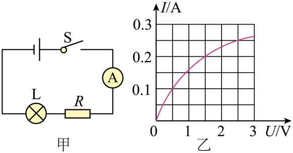

# Physics - 题目 44

**ID**: 232f8319919d4b10add36dfcea5f2f80
**年级**: Grade 9
**难度**: Medium
**题型**: Multiple-choice

## 题目
如图甲所示，电源电压恒为4.5V。​​​​​​​‌图乙是通过小灯泡L的电流I与其两端电压U的关系图像。闭合开关S后，电流表示数为0.2A，下列说法正确的是（      ）

## 解答

1. 由电路图可知，L与R串联，电流表测电路中的电流。
2. A．由图像可知，灯泡的电流与其两端电压的关系图线是一条曲线，所以通过小灯泡的电流与其两端的电压不成正比，故A错误；
3. B．由图像可知，电流表的示数为0.2A时，灯泡两端的电压 $U{{}_{{\rm{L}}}}={{1}}{{.}}{{5}}{\rm{V}}$ ，由串联电路的电压特点可知，电阻R两端的电压 $U{{}_{R}}=U﹣U{{}_{{\rm{L}}}}={{4}}{{.}}{{5}}{\rm{V}}﹣{{1}}{{.}}{{5}}{\rm{V}}={{3}}{\rm{V}}$ ，由欧姆定律得，电阻R的阻值
4. $R=\frac {U{{}_{R}}}{I}=\frac {{{3}}{\rm{V}}}{{{0}}{{.}}{{2}}{\rm{A}}}{\rm{=}}{{1}}{{5}}{\rm{Ω}}$ ，故B正确；
5. C．此时小灯泡L的电功率 $P{{}_{{\rm{L}}}}=U{{}_{{\rm{L}}}}I=1.5{\rm{V}}\times 0.2{\rm{A}}={{0}}{{.}}{{3}}{\rm{W}}$ ，故C错误；
6. D．通电10s整个电路消耗的电能 $W=UIt=4.{{5}}{\rm{V}}\times 0.2{\rm{A}}\times 10{\rm{s}}={{9}}{\rm{J}}$ ，故D错误。

## 知识点

**中文**:
  - 串联电路的电压规律
  - 欧姆定律的应用
  - 电功与电能的计算
  - 电功率的计算及应用

**English**:
  - Voltage Law in Series Circuits
  - Applications of Ohm's Law
  - Calculation of Electric Work and Energy
  - Calculation and Application of Electric Power

---
