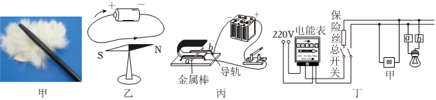

# Physics - 题目 799

**ID**: 25c31caaa6f140198efcb52c86a18fef
**年级**: Grade 9
**难度**: Medium
**题型**: Multiple-choice

## 题目
利用如图所示的装置进行实验，对实验现象解释正确的是（      ）​​​​​​​‌

## 解答

1. A．当毛皮与橡胶棒摩擦，毛皮上的电子转移到橡胶棒上，橡胶棒得到电子带负电，电荷只是转移了，没有创造电荷，故A错误；
2. B．磁场的基本性质是对放入其中的磁体产生磁力的作用，导线通电后小磁针发生偏转，说明通电导线周围存在磁场，故B错误；
3. C．通电金属棒在磁场中运动起来，是力改变了其运动状态，说明磁场对电流有力的作用，故C正确。
4. D．家庭电路中控制用电器的开关必须接在与火线相连的一侧，因为与b相连的导线装有保险丝，是火线，故开关应该接到b处，故D错误。

## 知识点

**中文**:
  - 家庭电路的连接
  - 摩擦起电的实质
  - 磁场对通电导线的作用
  - 电流的磁效应

**English**:
  - Connection of Household Circuits
  - Nature of Triboelectricity
  - Effect of Magnetic Field on Energized Wire
  - Magnetic Effect of Current

---
