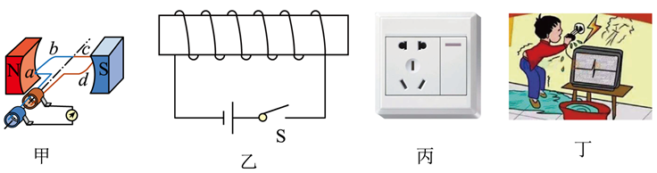

# Physics - 题目 64

**ID**: 28a7a764d05949fa9d2fb7d4b878ff86
**年级**: Grade 9
**难度**: Medium
**题型**: Multiple-choice

## 题目
关于如图所示情景，下列说法中正确的是（      ）​​​​​​​‌

## 解答

1. A．闭合线圈部分导体切割磁感线时会产生感应电流，即发电机的原理，故A正确；
2. B．根据安培定则，右手的四指方向为电流方向，那么大拇指所指的方向即为N极，故通电螺线管左端为N极，故B错误；
3. C．使用三孔插座和使用两孔插座效果是不一样的，因为三孔插座是有一个接触地线的，故C错误；
4. D．不可以用湿手摸或湿布擦与电源相连接的用电器，故D错误。
5. 故选A。

## 知识点

**中文**:
  - 安全用电原则
  - 插座和插头的接线及作用
  - 通电螺线管的磁场
  - 直流电动机的原理
  - 安培定则及其应用

**English**:
  - Principles of Safe Electricity Use
  - Wiring and Function of Sockets and Plugs
  - Magnetic Field of Energized Solenoid
  - Principle of DC Motor
  - Ampere's Rule and Applications

---
