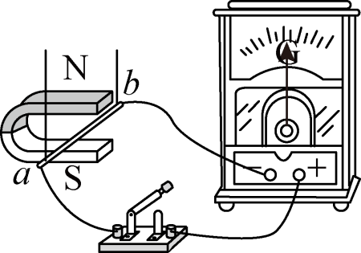

# Physics - 题目 2930

**ID**: 2fef3ce9d06c4297b3d9f061828d7f09
**年级**: Grade 9
**难度**: Medium
**题型**: Multiple-choice

## 题目
将导体ab、开关和灵敏电流计用导线连接，导体ab放置在磁极间，如图所示，下列说法正确的是（      ）​​​​​​​‌

## 解答

1. A．开关闭合，导体ab斜向上运动，导体ab做切割磁感线运动，产生感应电流，指针发生偏转，故A正确；
2. B．开关闭合，导体ab不动，磁铁上下运动，导体ab没有做切割磁感线运动，不产生感应电流，指针不偏转，故B错误；
3. C．开关断开，不是闭合回路，导体ab快速运动也不产生感应电流，指针不偏转，故C错误；
4. D．感应电流的方向跟导体切割磁感线的运动方向有关，开关闭合，磁铁不动，ab水平向左或水平向右快速移动，指针偏转方向不相同，故D错误。

## 知识点

**中文**:
  - 产生感应电流的条件
  - 影响感应电流方向的因素

**English**:
  - Conditions for Induced Current
  - Factors Affecting Direction of Induced Current

---
