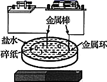

# Physics - 题目 1864

**ID**: 34c4cdd592334b1c9211e19a91aef024
**年级**: Grade 9
**难度**: Medium
**题型**: Multiple-choice

## 题目
一实验小组做了这样一个有趣的实验。​​​​​​​‌如图所示，他们将盛有适量盐水的玻璃皿置于条型磁铁的正上方，在干电池的两端分别接上一根金属棒，并在其中一个金属棒上接上一个金属环。将金属环平放于液面上，另一根金属棒竖直插入盐水中央（不接触金属环），再向盐水中撒入碎纸屑。闭合开关后，碎纸屑绕中央的金属棒沿相同方向转动起来，拿走磁体后碎纸屑停止转动。下列相关说法中正确的是（      ）

## 解答

1. AB．此题中有一个磁场，盐水是导体，即当通电后，盐水中的纸片转动，即说明盐水运动，说明通电盐水在磁场中受力的作用，故A项正确，B项错误；
2. C．由于纯水是绝缘体，即纯水中没有电流，所以若用纯水做实验时，纸屑不会转动，故C项错误；
3. D．将电源正负极对调，即电流方向改变，磁体的磁极对调，即磁场方向也改变，所以所受磁场力的方向不会改变，故闭合开关后碎纸屑会绕与原来方向相同的方向转动，故D项错误。

## 知识点

**中文**:
  - 导体和绝缘体的辨别
  - 磁场对通电导线的作用

**English**:
  - Distinguishing Conductors and Insulators
  - Effect of Magnetic Field on Energized Wire

---
