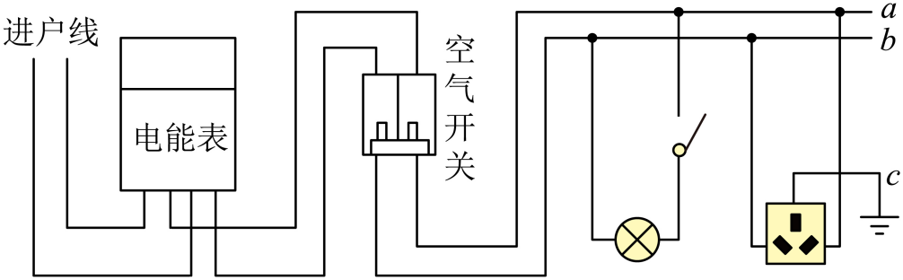

# Physics - 题目 2255

**ID**: 3a6a2e97a1d2468d90ab597a5d49da76
**年级**: Grade 9
**难度**: Medium
**题型**: Multiple-choice

## 题目
图示为某家庭电路示意图，关于该家庭电路，下列说法正确的是（      ）​​​​​​​‌

## 解答

1. A．由图可知，开关接在导线a上，故导线a是火线，故A错误；
2. B．电能表上计数器示数的单位是千瓦时，故B错误；
3. C．家庭电路中发生短路或者用电器总功率过大都会导致空气开关跳闸，故C正确；
4. D．正确使用试电笔插入三孔插座的某一孔，氖管灯不亮，该孔可能是零线，也可能是地线，故D错误。

## 知识点

**中文**:
  - 家庭电路的故障分析
  - 电能表的读数及电能的求解
  - 家庭电路的连接
  - 测电笔的结构和使用

**English**:
  - Fault Analysis of Household Circuits
  - Reading Energy Meters and Calculating Energy
  - Connection of Household Circuits
  - Structure and Use of Test Pen

---
