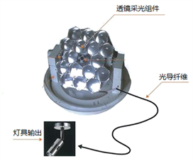

# Physics - 题目 1885

**ID**: 3b7f4a7fdcaa447580c58cd3cf053a08
**年级**: Grade 9
**难度**: Medium
**题型**: Multiple-choice

## 题目
有一种安全环保的照明系统，可为地下室、煤矿、油田等地下场所提供日间照明。​​​​​​​‌如图所示为该系统将阳光导入灯具的示意图。透镜采光组件收集室外的阳光，并使其集中从光导纤维的一端射入，从连接在纤维另一端的灯具射出。下列有关分析正确的是（      ）

## 解答

1. AB．凸透镜对光有会聚作用，所以透镜采光组件相当于凸透镜，将阳光会聚到光导纤维中，故A正确，B错误；
2. CD．光导纤维内的光在纤维内不断发生全反射，没有光穿过光导纤维外壁射出，故CD错误。
3. 故选A。

## 知识点

**中文**:
  - 凸透镜的会聚作用

**English**:
  - Converging Effect of Convex Lenses

---
