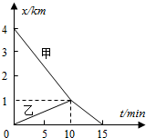

# Physics - 题目 2098

**ID**: 3e802fe14e6744ca9ccbbece30bc214b
**年级**: Grade 9
**难度**: Medium
**题型**: Multiple-choice

## 题目
甲同学骑自行车沿直线公路去看望乙同学，得知消息后，乙同学步行去迎接，接到后一同原路返回，整个过程他们的位置与时间的关系如图所示，由图可知（      ）​​​​​​​‌

## 解答

1. 由图像知，整个过程中，两同学都做匀速直线运动，乙同学出发时，甲与乙的距离为4km，经10min，两人相遇，乙所走路程为1km，此时甲通过的路程为3m。相遇后，两人在5min内通过的路程为1m。相遇前，甲、乙的速度分别为
2. $v{{}_{甲}}=\frac {s{{}_{甲}}}{t{{}_{1}}}=\frac {3{\rm{k}}{\rm{m}}}{\frac {10}{60}{\rm{h}}}=18{\rm{k}}{\rm{m}}{\rm{/}}{\rm{h}}$ ， $v{{}_{乙}}=\frac {s{{}_{乙}}}{t{{}_{1}}}=\frac {{\rm{1}}{\rm{k}}{\rm{m}}}{\frac {10}{60}{\rm{h}}}=6{\rm{k}}{\rm{m}}{\rm{/}}{\rm{h}}$
3. 即
4. v_{甲}=3v_{乙}
5. 相遇后，甲的速度
6. $v{{}_{甲}}＇=\frac {s{{}_{甲}}＇}{t{{}_{2}}}=\frac {{\rm{1}}{\rm{k}}{\rm{m}}}{\frac {5}{60}{\rm{h}}}=12{\rm{k}}{\rm{m}}{\rm{/}}{\rm{h}}$
7. 即
8. v_{甲}=1.5v_{甲}＇
9. 整个过程中，甲、乙的平均速度分别为
10. $v{{}_{甲总}}=\frac {s{{}_{甲总}}}{t}=\frac {3{\rm{k}}{\rm{m}}+{\rm{1}}{\rm{k}}{\rm{m}}}{\frac {15}{60}{\rm{h}}}=16{\rm{k}}{\rm{m}}{\rm{/}}{\rm{h}}$ ， $v{{}_{乙总}}=\frac {s{{}_{乙总}}}{t}=\frac {{\rm{1}}{\rm{k}}{\rm{m}}+{\rm{1}}{\rm{k}}{\rm{m}}}{\frac {15}{60}{\rm{h}}}=8{\rm{k}}{\rm{m}}{\rm{/}}{\rm{h}}$
11. 即
12. v_{乙}_{总}=0.5v_{甲}_{总}
13. 故A符合题意，BCD不符合题意。
14. 故选A。

## 知识点

**中文**:
  - 速度公式及其应用
  - 速度的图像问题

**English**:
  - Velocity Formula and Applications
  - Velocity-Time Graphs

---
