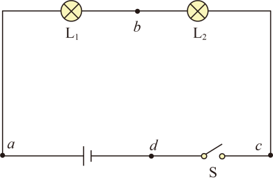

# Physics - 题目 987

**ID**: 44b3ffa19241485d9f8a807d59403d2c
**年级**: Grade 9
**难度**: Medium
**题型**: Multiple-choice

## 题目
如图所示，开关S闭合时，小灯泡 ${\rm{L}}{{}_{{{1}}}}$ 、 ${\rm{L}}{{}_{{{2}}}}$ 都不亮，用一段导线的两端接触a、b两点时两小灯泡都不亮；接触b、c两点时， ${\rm{L}}{{}_{{{1}}}}$ 亮、 ${\rm{L}}{{}_{{{2}}}}$ 不亮；接触c、d两点时，两小灯泡也不亮。​​​​​​​‌对此，下列判断中可能的是（      ）

## 解答

1. A．如果灯L_{1}断路，用一段导线的两端接触a、b两点时，L_{2}会发光，故A不符合题意；
2. B．如果灯L_{2}断路，导线接触b、c两点时，L_{1}会发光， ${\rm{L}}{{}_{{{2}}}}$ 不亮，故B符合题意；
3. C．如果开关断路，导线接触c、d两点时，电路是通路，两灯都发光，故C不符合题意；
4. D．如果灯L_{2}短路，闭合开关，L_{1}会发光，故D不符合题意。

## 知识点

**中文**:
  - 串、并联电路中短路和断路的分析

**English**:
  - Analysis of Short and Open Circuits

---
