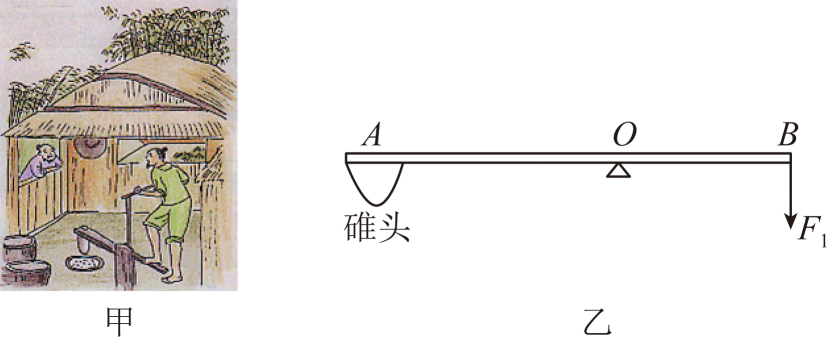

# Physics - 题目 32

**ID**: 4d8f332c54af4d259744ea0ceacb9df5
**年级**: Grade 9
**难度**: Medium
**题型**: Multiple-choice

## 题目
图甲是《天工开物》里记载的一种捣谷的舂，“横木插碓头，硬嘴为铁，足踏其末而舂之”。​​​​​​​‌舂可以简化为图乙所示模型，碓头质量为10kg，OA长度为1.2m，OB长度为0.8m。不计横木AB的重力和转动摩擦，g取10N/kg，则（      ）

## 解答

1. A．用舂倒谷时，动力臂小于阻力臂，是费力杠杆，故A不符合题意；
2. BD．捣谷人垂直于横木向下踏时，动力臂最长，根据杠杆平衡原理 $F{{}_{1}}L{{}_{1}}=F{{}_{2}}L{{}_{2}}$ 可知垂直向下踏时最省力，则撬动碓头的最小力为 $F{{}_{1}}=\frac {F{{}_{2}}L{{}_{2}}}{L{{}_{1}}}=\frac {mg\cdot OA}{OB}=\frac {10{\rm{k}}{\rm{g}}\times 10{\rm{N}}{\rm{/}}{\rm{k}}{\rm{g}}\times 1.2{\rm{m}}}{0.8{\rm{m}}}=150{\rm{N}}$ 故B不符合题意，D符合题意；
3. C．重力做功为 $W=Gh=mgh=10{\rm{k}}{\rm{g}}\times 10{\rm{N}}{\rm{/}}{\rm{k}}{\rm{g}}\times 0.3{\rm{m}}{\rm{=}}{{3}}{{0}}{\rm{J}}{\rm ，}$ 故C不符合题意。
4. 故选D。

## 知识点

**中文**:
  - 有用功、额外功和总功的计算
  - 杠杆平衡条件的应用
  - 杠杆的分类

**English**:
  - Calculation of Useful, Extra, and Total Work
  - Application of Lever Equilibrium Conditions
  - Classification of Levers

---
