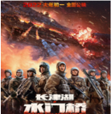

# Physics - 题目 569

**ID**: 56baa2a280cd4e4ba3f11e3407a0f76e
**年级**: Grade 9
**难度**: Medium
**题型**: Multiple-choice

## 题目
下图《长津湖之水门桥》是今年春节档最火热的一部影片，里面很多桥段真实再现了那些革命先辈英勇无畏的感人事迹，激发了国人的爱国情怀。​​​​​​​‌其中有战士敲打管道提醒战友有危险；连长伍千里中枪掉落山坡，最后敌人还残忍的用火焰枪去烧。下列描述正确的是（      ）

## 解答

1. A．敲打管道主要是为了增大声音的响度，故A错误；
2. B．物体自由下落过程，质量不变，高度减小，重力势能减小，速度增大，动能增大，是重力势能转化为动能，故B错误；
3. C．衣服上的冰块烧成了水，冰由固态变成液态，是熔化过程，故C正确；
4. D．电影中石头道具通常是采用泡沫作为材料，是利用泡沫密度较小，故D错误。
5. 故选C。

## 知识点

**中文**:
  - 动能和势能的转化
  - 响度
  - 密度的应用与物质鉴别
  - 熔化与熔化吸热的特点

**English**:
  - Transformation between Kinetic and Potential Energy
  - Loudness
  - Applications of Density and Material Identification
  - Melting and Heat Absorption

---
