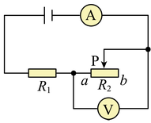

# Physics - 题目 312

**ID**: 5b55b81612b94f18a4475356d9508575
**年级**: Grade 9
**难度**: Medium
**题型**: Multiple-choice

## 题目
如图所示，电源电压不变，滑动变阻器的滑片P从a端滑到b端的过程中（      ）​​​​​​​‌

## 解答

1. 由图所示，滑动变阻器R_{2}和定值电阻R_{1}是串联，电压表测量变阻器两端的电压，当滑动变阻器的滑片P从a端滑到b端的过程中，滑动变阻器的电阻变大，根据串联电路电阻特点，总电阻变大，电源电压不变，由 $I=\frac {U}{R}$ 可知，电路中电流变小，所以电流表的示数变小；对于定值电阻其两端的电压U_{1}=IR_{1}，电阻不变，电流变小，所以电压变小，根据串联电路电压特点，滑动变阻器两端的电压变大，所以电压表的示数变大。
2. 故选C。

## 知识点

**中文**:
  - 动态电路中电表示数的变化
  - 欧姆定律的应用
  - 电路的动态分析

**English**:
  - Changes in Meter Readings in Dynamic Circuits
  - Applications of Ohm's Law
  - Dynamic Circuit Analysis

---
