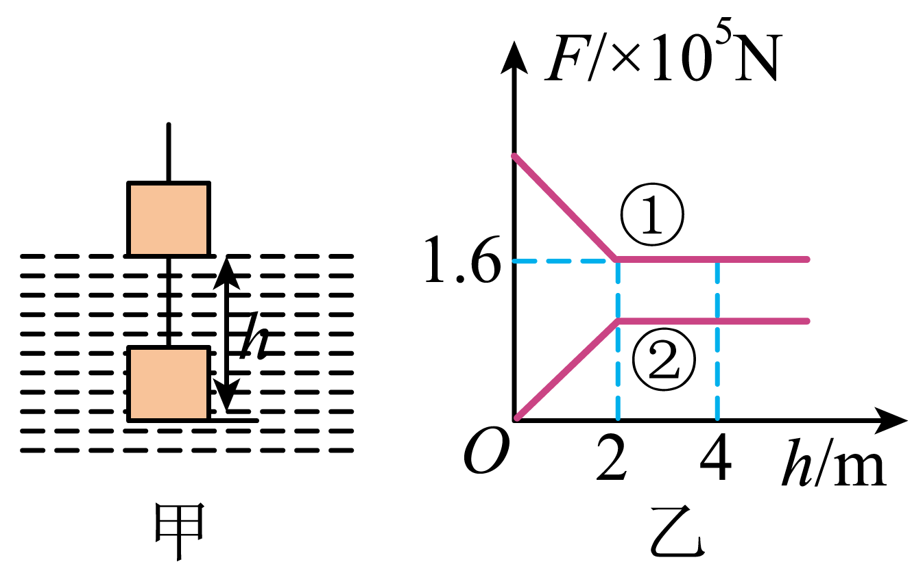

# Physics - 题目 2691

**ID**: 66a7afccc6414ac48ee54667cc0c5c8c
**年级**: Grade 9
**难度**: Medium
**题型**: Multiple-choice

## 题目
建设桥梁的过程中，要向水中沉放大量的施工构件。​​​​​​​‌如图甲所示，假设一正方体构件从江面被匀速吊入江水中，在沉入过程中，其下表面到水面的距离h逐渐增大，构件所受浮力F_{1}、钢绳拉力F_{2}随h的变化如图乙所示（ρ_{水}＝1 × 10^{3}kg/m^{3}）。下列判断正确的是（      ）

## 解答

1. A．由图乙可知，当下表面到水面的距离达到2m后，浮力、拉力不再发生变化，这表明当下表面到水面的距离为2m时，构件恰好完全浸没，所以构件的长度为2m，故A错误；
2. BCD．由题意可得，构件浸入水中的过程中，排开水的体积变大，构件受到的浮力变大，拉力变小，当构件完全浸没在水中时，浮力最大，此时拉力最小，由图乙可得，拉力最小为1.6×10^{5}N，因为构件的体积为
3. V=2m×2m×2m=8m^{3}
4. 所以构件完全浸没时，所受浮力为
5. F_{1}=ρ_{水}gV_{排}=ρ_{水}gV=1×10^{3}kg/m^{3}×10N/kg×8m^{3}=8×10^{4}N
6. 又因为构件从江面被匀速吊入江水中，处于平衡状态，对构件进行受力分析可得，构件受到重力、拉力和浮力，且重力等于拉力与浮力的和，所以可得构件所受重力为
7. G=F_{1}+F_{2}=1.6×10^{5}N+8×10^{4}N=2.4×10^{5}N
8. 所以构件的质量为
9. $m=\frac {G}{g}=\frac {2.4\times {{1}}{{0}}{^{5}}{\rm{N}}}{10{\rm{N}}{\rm{/}}{\rm{k}}{\rm{g}}}=2.4\times {{1}}{{0}}{^{4}}{\rm{k}}{\rm{g}}$
10. 所以构件的密度为
11. $ρ=\frac {m}{V}=\frac {2.4\times {{1}}{{0}}{^{4}}{\rm{k}}{\rm{g}}}{8{\rm{m}}{^{3}}}=3\times {{1}}{{0}}{^{{{3}}}}/{\rm{m}}{^{3}}$
12. 故B正确，CD错误。

## 知识点

**中文**:
  - 二力及多力平衡的判断和应用
  - 密度公式的应用
  - 重力公式的应用
  - 浮力大小的计算
  - 阿基米德原理的应用

**English**:
  - Judgment and Application of Equilibrium of Forces
  - Application of Density Formula
  - Application of Gravity Formula
  - Calculation of Buoyancy
  - Applications of Archimedes' Principle

---
