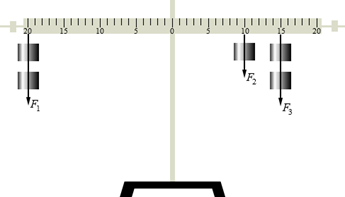

# Physics - 题目 1754

**ID**: 73ef8b41879c47c7ba79a108fe57af8e
**年级**: Grade 9
**难度**: Medium
**题型**: Multiple-choice

## 题目
小明做探究杠杆平衡条件的实验时将手中的5个钩码挂成了如图所示的情况，则（      ）​​​​​​​‌

## 解答

1. A．假设一个钩码的重力为G
2. F_{1}=2G，F_{2}=G，F_{3}=2G
3. 各力力臂为
4. L_{1}=20，L_{2}=10，L_{3}=15
5. F_{1}L_{1}=2G20=40G
6. F_{2}L_{2}=G10=10G
7. F_{3}L_{3}=2G15=30G
8. 杠杆平衡的条件为
9. F_{1}L_{1}=F_{2}L_{2}+F_{3}L_{3}
10. 故A不符合题意；
11. B．在F_{1}和F_{2}的下方各再挂一个钩码后
12. F_{1}L_{1}=3G20=60G
13. F_{2}L_{2}=2G10=20G
14. F_{3}L_{3}=2G15=30G
15. F_{1}L_{1}>F_{2}L_{2}+F_{3}L_{3}
16. 杠杆失去平衡，故B不符合题意；
17. C．取下F_{1}下的一个钩码并将F_{2}的钩码取下后
18. F_{1}L_{1}=G20=20G
19. F_{2}L_{2}=0
20. F_{3}L_{3}=2G15=30G
21. F_{1}L_{1}<F_{2}L_{2}+F_{3}L_{3}
22. 杠杆失去平衡，故C不符合题意；
23. D．取下F_{2}下的钩码并将F_{3}的钩码向右移至20cm处后
24. F_{1}L_{1}=2G20=40G
25. F_{2}L_{2}=0
26. F_{3}L_{3}=2G20=40G
27. F_{1}L_{1}=F_{2}L_{2}+F_{3}L_{3}
28. 杠杆重新平衡，故D符合题意。
29. 故选D。

## 知识点

**中文**:
  - 杠杆平衡条件的应用

**English**:
  - Application of Lever Equilibrium Conditions

---
