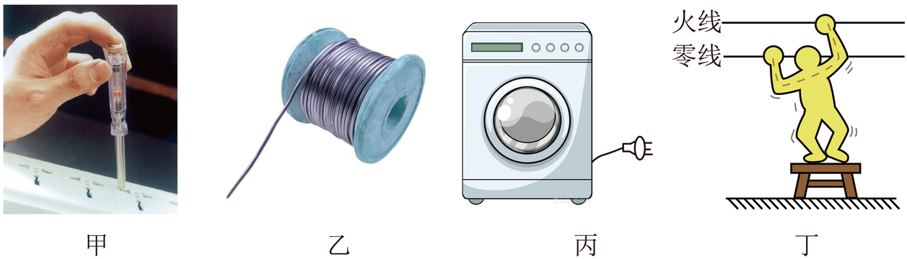

# Physics - 题目 2477

**ID**: 74f990836a8f4537aab212b8cbdced50
**年级**: Grade 9
**难度**: Medium
**题型**: Multiple-choice

## 题目
关于家庭电路，下列说法正确的是（      ）​​​​​​​‌

## 解答

1. A．图甲：使用螺丝刀试电笔时用指尖抵住上端的金属帽，能够构成通路，不会造成触电事故故A错误；
2. B．图乙：为了用电安全，保险丝熔断后，不可用铜丝、铁丝等代替保险丝，因为铜丝、铁丝的熔点高，电流过大时，不会自动切断电路故B错误；
3. C．图丙：将洗衣机的三脚插头插入三孔插座后，洗衣机的金属外壳会与大地相连，防止因漏电发生触电故C正确；
4. D．图丁：人站在干燥的木凳上同时接触火线和零线，人会触电；火线和零线中的电流相同，此时漏电保护器不会切断电路故D错误。

## 知识点

**中文**:
  - 插座和插头的接线及作用
  - 测电笔的结构和使用
  - 熔断器的作用及保险丝的选择
  - 触电危害及常见的触电类型与预防

**English**:
  - Wiring and Function of Sockets and Plugs
  - Structure and Use of Test Pen
  - Fuses and their Selection
  - Electric Shock Hazards, Types, and Prevention

---
