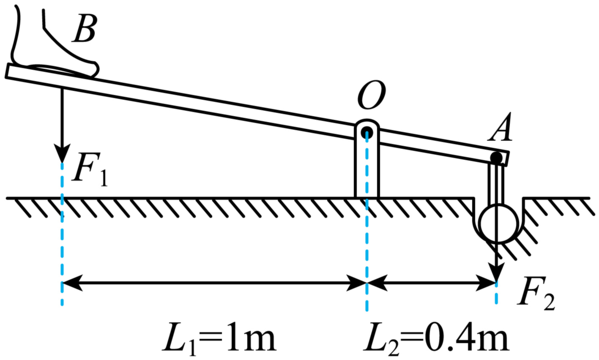

# Physics - 题目 2376

**ID**: 7749ed8a75fb4054909a5ab199ceb690
**年级**: Grade 9
**难度**: Medium
**题型**: Multiple-choice

## 题目
如图是我国古代人民的智慧成果——舂米工具的示意图，杆AB可绕O点转动，脚踏B端可以使A端的石球升高，抬起脚，石球会落下击打稻谷。​​​​​​​‌若石球的体积为 $2\times 10{^{3}}{\rm{c}}{\rm{m}}{^{3}}$ 、密度为 $2.5\times 10{^{3}}{\rm{k}}{\rm{g}}/{\rm{m}}{^{3}}$ ，不计杆的自重和摩擦。g取 $10{\rm{N}}/{\rm{k}}{\rm{g}}$ ，则下列说法正确的是（      ）

## 解答

1. A．从图中可以看到，脚踏B端，脚对B端竖直向下的力为动力，石球对A端的拉力为阻力，动力臂为L_{1}=1m
2. 阻力臂为L_{2}=0.4m
3. 动力臂大于阻力臂，这杠杆为省力杠杆。杠杆是一种机械，使用任何机械都不省功，故A错误；
4. B．由题意可知，该石球的体积为
5. V=2×10^{3}cm^{3}=2×10^{-3}m^{3}
6. 密度为ρ=2.5×10^{3}kg/m^{3}
7. 则由 $ρ=\frac {m}{V}$ 可得，该石球的质量为
8. $m=ρV=2.5\times 10{^{3}}kg/{\rm{m}}{^{3}}\times 2\times 10{^{-3}}{\rm{m}}{^{3}}=5kg$
9. 由 $G=mg$ 可得，石球受到的重力为
10. $G=mg=5kg\times 10{\rm{N}}/kg=50{\rm{N}}$
11. 将石球抬起，可把石球的运动状态看作平衡状态，杠杆对石球的拉力为50N，石球对杠杆的拉力也为50N，为阻力，F1为动力，根据杠杆的平衡条件，可得
12. F_{1}L_{1}=F_{2}L_{2}
13. 代入数据可得 $F{{}_{1}}\times 1{\rm{m}}=50{\rm{N}}\times 0.4{\rm{m}}$
14. 解得F_{1}=20N
15. 故BC错误；
16. D．由图可知，杆的重心与脚的位置在支点的同一侧，如果考虑杆重的话，根据杠杆的平衡条件可知
17. F_{1}L_{1}+G_{杆}×L_{杆}=F_{2}L_{2}则脚会更省力，故D正确。

## 知识点

**中文**:

**English**:

---
