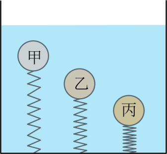

# Physics - 题目 788

**ID**: 7a0368d244284a5c954a4d52f741ba70
**年级**: Grade 9
**难度**: Medium
**题型**: Multiple-choice

## 题目
如图所示，三个相同的轻质弹簧，一端固定在容器底部，另一端分别与甲、乙、丙三个体积相同的实心球相连。​​​​​​​‌向容器内倒入水，待水和球都稳定后，观察到如图所示的情况，此时乙球下方弹簧长度等于原长。下列判断错误的是（      ）

## 解答

1. 根据题意可知，乙球下方弹簧长度等于原长，则弹簧对乙球没有作用力；观察如图情况可知，甲球下方弹簧长度大于原长，则弹簧对甲球有向下的拉力F_{拉}；丙球下方弹簧长度小于原长，则弹簧对丙球有向上的支持力F_{支}；由题知，三个球处于静止，所以F_{甲}=G_{甲}+F_{拉}_{，}F_{乙}=G_{乙}_{，}F_{丙}=G_{丙}-F_{支}_{，}
2. AB．比较可知，F_{甲}＞G_{甲}，F_{乙}=G_{乙}，F_{丙}＜G_{丙}，故AB正确，不符合题意；
3. CD．已知三个实心球体积相同，由于三个球浸没在同种液体中，则排开液体的体积相同，根据F_{浮}=ρ_{液}V_{排}g可知，它们受到的浮力F_{甲}=F_{乙}=F_{丙}_{，}所以三个球的重力关系为G_{甲}＜G_{乙}＜G_{丙}_{，}根据重力公式可知，三个球的质量关系为m_{甲}＜m_{乙}＜m_{丙}_{，}已知三个球的体积相同，根据 $ρ=\frac {m}{V}$  可知，ρ_{甲}＜ρ_{乙}＜ρ_{丙}_{，}故C正确，不符合题意，故D错误，符合题意。

## 知识点

**中文**:
  - 力的合成与应用
  - 阿基米德原理的应用
  - 物体的浮沉条件及其应用

**English**:
  - Composition of Forces and Applications
  - Applications of Archimedes' Principle
  - Floating/Sinking Conditions and Applications

---
