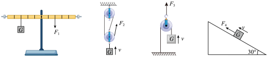

# Physics - 题目 2162

**ID**: 7a83db8f2e3a4abc8961018e33655355
**年级**: Grade 9
**难度**: Medium
**题型**: Multiple-choice

## 题目
如图所示，物重为G的物体在下列四种情景中均处于平衡状态（不计机械自重和摩擦），拉力F_{1}、F_{2}、F_{3}、F_{4}的大小关系是（      ）​​​​​​​‌

## 解答

1. 使用等臂杠杆时，不省力、不费力；滑轮组上有3股绳子时，用总重力的三分之一；倒用的动滑轮，费力；使用斜面上，由于夹角为30°，斜面上的拉力是物体重力的一半；所以最省力的是滑轮组，其次是斜面、杠杆，费力的是倒用的动滑轮。
2. 故选A。

## 知识点

**中文**:
  - 动滑轮及其工作特点
  - 杠杆平衡条件的应用
  - 滑轮组及其工作特点
  - 斜面与轮轴

**English**:
  - Movable Pulleys and Operating Characteristics
  - Application of Lever Equilibrium Conditions
  - Pulley Systems and Operating Characteristics
  - Inclined Plane and Wheel & Axle

---
