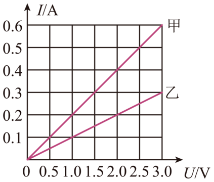

# Physics - 题目 1379

**ID**: 7f42bf349d714eb8be68bf3ca9522e78
**年级**: Grade 9
**难度**: Medium
**题型**: Multiple-choice

## 题目
张华同学在“探究通过导体的电流与其两端电压的关系”时，将记录的实验数据通过整理作出了如图所示的图象，根据图象，下列说法错误的是​​​​​​​‌

## 解答

1. A. 由图象可知，当在导体乙的两端加上1V的电压时，通过导体乙的电流为0.1A，故A正确；B. 将甲、乙两导体并联后接到电压为3V的电源上时，因并联电路中各支路两端的电压相等，所以,U_{甲}＝U_{乙}＝3V，由图象可知,此时通过两导体的电流分别为I_{甲}＝0.6A，I_{乙}＝0.3A，因并联电路中干路电流等于各支路电流之和，所以，干路中的电流：I＝I_{甲}+I_{乙}＝0.6A+0.3A＝0.9A，故B正确；C. 由图象可知，通过甲、乙两电阻的电流与各自两端的电压成正比例函数，即通过导体甲、乙的电流与两端的电压成正比，故C正确；D. 由图象可知,当U_{甲}＝U_{乙}＝3V时,I_{甲}＝0.6A>I_{乙}＝0.3A，由I＝ $\frac {{\rm{U}}}{{\rm{R}}}$ 的变形式R＝ $\frac {U}{I}$ 可知,R_{甲}<R_{乙}，故D错误．故选D．
2. 【点睛】
3. （1）根据图象直接读出导体乙的两端加上1V的电压时通过的电流；（2）将甲、乙两导体并联后接到电压为3V的电源上时它们两端的电压相等，根据图象读出通过两导体的电流，根据并联电路的电流特点求出干路电流；（3）由图象可知，通过两导体的电流与各自两端的电压成正比例函数即为定值电阻；（4）根据欧姆定律比较两导体的电阻关系．

## 知识点

**中文**:
  - 并联电路的电压规律
  - 并联电路的电流规律
  - 欧姆定律的应用

**English**:
  - Voltage Law in Parallel Circuits
  - Current Law in Parallel Circuits
  - Applications of Ohm's Law

---
