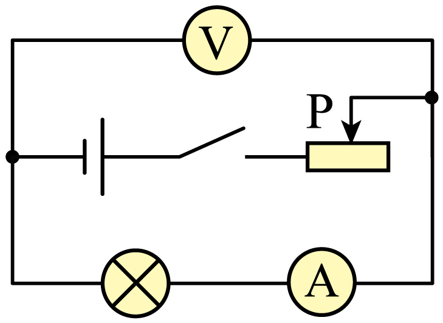

# Physics - 题目 2834

**ID**: 8208a6ef606f468ea06d114cbe513734
**年级**: Grade 9
**难度**: Medium
**题型**: Multiple-choice

## 题目
如图所示的电路中，电源电压不变，闭合开关后，当滑片P在某一端点时，电流表示数为0.4A，小灯泡消耗的功率为0.4W；当滑片P移至中点时，电压表示数变化了1.5V，此时小灯泡正常发光，且消耗的功率为1.5W。​​​​​​​‌下列说法中正确的是（      ）

## 解答

1. 由电路图可知，小灯泡与滑动变阻器串联，电压表测小灯泡两端的电压，电流表测电路中的电流。当滑片P在某一端点时，电流I_{1}=0.4A，小灯泡功率P_{L1}=0.4W。根据P=UI可得此时小灯泡两端电压 $U{{}_{{\rm{L}}1}}=\frac {P{{}_{{\rm{L}}1}}}{I{{}_{1}}}=\frac {0.4{\rm{W}}}{0.4{\rm{A}}}=1{\rm{V}}$ ，当滑片P移至中点时，小灯泡正常发光，功率P_{L2}=1.5W，电压表示数变化了1.5V，由于小灯泡消耗的功率变大可知，小灯泡两端电压增大，所以此时小灯泡两端电压 $U{{}_{{\rm{L}}2}}=U{{}_{{\rm{L}}1}}+1.5{\rm{V}}=1{\rm{V}}+1.5{\rm{V}}=2.5{\rm{V}}$ ，根据 $P=\frac {U{^{2}}}{R}$ 可得小灯泡正常发光时的电阻 $R{{}_{{\rm{L}}}}=\frac {U{{}_{{\rm{L}}2}}{^{2}}}{P{{}_{{\rm{L}}2}}}=\frac {{\left({2.5{\rm{V}}}\right)^{2}}}{1.5{\rm{W}}}\approx 4.17{\rm{Ω}}$ ，此时电路中的电流 $I{{}_{2}}=\frac {P{{}_{{\rm{L}}2}}}{U{{}_{{\rm{L}}2}}}=\frac {1.5{\rm{W}}}{2.5{\rm{V}}}=0.6{\rm{A}}$ ，设电源电压为U，滑动变阻器最大阻值为R。当滑片在某一端点（阻值最大端）时，根据串联电路电压规律U=U_{L1}+I_{1}R，即U=1V+0.4A×R①，当滑片在中点时，滑动变阻器接入阻值为R_{2}，此时U=U_{L2}+I_{2}×R_{2}，即U=2.5V+0.6A×R_{2}②，联立①②可得 $1{\rm{V}}+0.4{\rm{A}}\times R=2.5{\rm{V}}+0.3{\rm{A}}\times R{\rm \mathit{，}}$ 则0.1A×R=1.5V，解得R=15Ω，将R=15Ω代入①可得 $U=1{\rm{V}}+0.4{\rm{A}}\times 15{\rm{Ω}}=7{\rm{V}}{\rm \mathit{，}}$ 滑片在中点时，滑动变阻器接入阻值 $R{{}_{中}}=\frac {15{\rm{Ω}}}{2}=7.5{\rm{Ω}}{\rm \mathit{，}}$ 电流I_{2}=0.6A。则滑动变阻器的滑片P在中点时，滑动变阻器所消耗的电功率 $P{{}_{滑}}=I{{}_{2}}{^{2}}\times R{{}_{中}}={\left({0.6{\rm{A}}}\right)^{2}}\times 7.5{\rm{Ω}}=2.7{\rm{W}}{\rm \mathit{，}}$ 综上所述，故ABD错误，C正确

## 知识点

**中文**:
  - 与欧姆定律有关的动态电路计算

**English**:
  - Calculations in Dynamic Circuits using Ohm's Law

---
