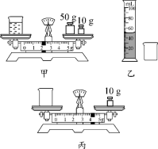

# Physics - 题目 2070

**ID**: 8476183ac44a4d7fb11246384549cad9
**年级**: Grade 9
**难度**: Medium
**题型**: Multiple-choice

## 题目
小明用天平、量筒和烧杯测某种食用油的密度，图甲、乙、丙表示了他的主要操作过程,几位同学对他的实验提出了如下看法，你认为正确的是（      ）​​​​​​​‌

## 解答

1. A．图甲中可以看出，烧杯和食用油的质量为62g，图丙中可以看出，烧杯的质量为14g，所以测得的油的质量为48g，故A 错误，不符合题意；
2. B．从图乙中可以看出，量筒的分度值为10mL，所测油的体积为50mL，所以油的密度
3. $ρ=\frac {m}{V}=\frac {{\rm{4}}{\rm{8}}{\rm{g}}}{{\rm{5}}{\rm{0}}{\rm{c}}{\rm{m}}{^{3}}}{\rm{=}}{\rm{0}}{\rm{.}}{\rm{9}}{\rm{6}}{\rm{g}}{\rm{/}}{\rm{c}}{\rm{m}}{^{{\rm{3}}}}$
4. 故B错误，不符合题意；
5. CD．若实验中先测空烧杯的质量，再将适量油倒入烧杯中测出烧杯和油的质量，最后将油全部倒入量筒中测量油的体积。这样会有部分油残留在烧杯上，使测得的油的体积变小，使得测得的密度比较大。正确的做法是先测量烧杯和油的质量，再将油倒入量筒中测出油的体积，最后测量剩下的油和烧杯的质量。故C错误，不符合题意；D正确，符合题意。
6. 故选D。

## 知识点

**中文**:
  - 液体密度的测量实验

**English**:
  - Experiment: Measuring Density of Liquids

---
