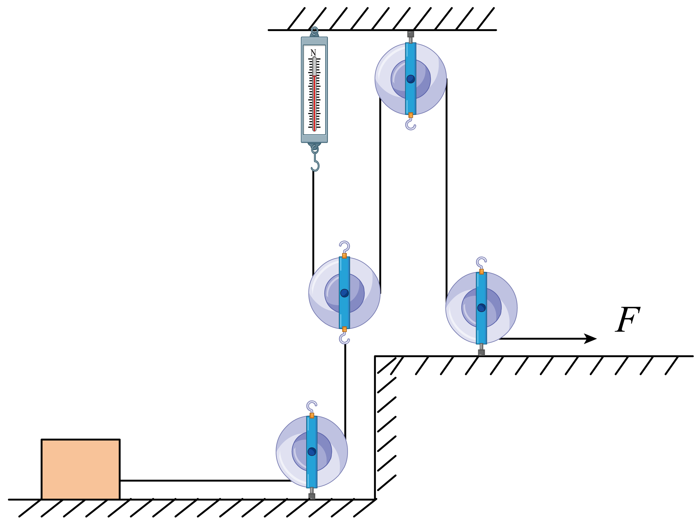

# Physics - 题目 594

**ID**: 84a07ff648f74030aa77a8b13361203f
**年级**: Grade 9
**难度**: Medium
**题型**: Multiple-choice

## 题目
使用如图所示的滑轮组，沿水平方向匀速拉动质量为300kg的物体，弹簧测力计的示数为200N，物体在10s内移动1m。​​​​​​​‌物体所受的摩擦力为物重的0.1倍。不计绳重和滑轮组内的摩擦，下列说法正确的是（      ）

## 解答

1. A．物体的重力
2. G=mg=300kg×10N/kg=3000N
3. 物体受到的摩擦力
4. f=0.1G=0.1×3000N=300N
5. 则拉力F克服物体摩擦力做的有用功
6. W有=fL=300N×1m=300J
7. 由图可知，动滑轮用2段绳子拉物体，且弹簧测力计的示数为200N，则拉力F=200N，绳子自由端移动的距离s=2m，拉力做的总功
8. W总=Fs=200N×2m=400J
9. 滑轮组的效率
10. $η=\frac {W{{}_{有}}}{W{{}_{总}}}=\frac {300{\rm{J}}}{400{\rm{J}}}\times 100{\rm{\%}}=75{\rm{\%}}$
11. 故A错误；
12. B．由 $F=\frac {1}{n}\left ({f+G{{}_{动}}}\right )$ 可知，动滑轮重
13. G动=nF-f=2×200N-300N=100N
14. 故B正确；
15. C．拉力的功率
16. $P=\frac {W{{}_{总}}}{t}=\frac {400{\rm{J}}}{10{\rm{s}}}=40{\rm{W}}$
17. 故C错误；
18. D．若增大物重，则物体受到的摩擦力变大，物体移动相同的距离，滑轮组所做的有用功变大，而额外功不变，有用功在总功中所占的比例变大，因此机械效率会变大，故D错误。
19. 故选B。

## 知识点

**中文**:
  - 功、功率、机械效率的综合计算
  - 滑轮组及其工作特点

**English**:
  - Comprehensive Calculation of Work, Power, and Efficiency
  - Pulley Systems and Operating Characteristics

---
