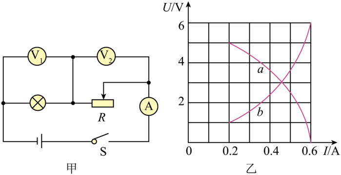

# Physics - 题目 2410

**ID**: 920d2576a12744958eb2d4faaa0c7e2d
**年级**: Grade 9
**难度**: Medium
**题型**: Multiple-choice

## 题目
图甲所示电路的电源电压保持不变，闭合开关后，将滑动变阻器的滑片由最右端向最左端移动的过程中，两电压表与电流表的示数变化关系如图乙所示，则（      ）​​​​​​​‌

## 解答

1. A．分析电路图可知，灯泡与滑动变阻器串联，电压表V_{1}测灯泡两端电压，电压表V_{2}测滑动变阻器两端电压，电流表测电路电流。滑动变阻器的滑片由最右端向最左端移动的过程中，电阻越来越小，电路总电阻越来越小，根据欧姆定律可知，电路电流变大，当滑动变阻器阻值最小时，电路电流最大，此时滑动变阻器两端电压为零，因此a是滑动变阻器的U-I图线，故A错误；
2. B．b是灯泡的U-I图线，由图可知，小灯泡的电阻随电压的增大而增大，当电压为6V时，灯泡有最大电阻 $R{{}_{{\rm{L}}大}}=\frac {6{\rm{V}}}{0.6{\rm{A}}}=10{\rm{Ω}}$ ，故B错误；
3. C．a是灯泡的U-I图线，由图可知，当电流最小时，滑动变阻器在最大阻值处，即 $R{{}_{滑大}}=\frac {5{\rm{V}}}{0.2{\rm{A}}}=25{\rm{Ω}}$ ，故C正确；
4. D．根据图像可知，当滑动变阻器阻值为零时，电流最大，此时灯泡两端电压等于电源电压，因此电源电压为6V，根据P=UI，当电流最大时，电路的功率最大P_{大}=UI_{大}=6V×0.6A=3.6W，故D错误。

## 知识点

**中文**:
  - 与欧姆定律有关的动态电路计算
  - 电功率的计算及应用

**English**:
  - Calculations in Dynamic Circuits using Ohm's Law
  - Calculation and Application of Electric Power

---
