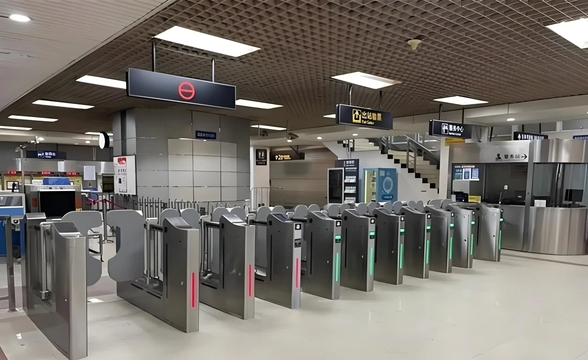

# Physics - 题目 1561

**ID**: 93ac822f71e9488d9880157b31922557
**年级**: Grade 9
**难度**: Medium
**题型**: Multiple-choice

## 题目
为了提高乘客进站的效率，高铁站的自助检票闸机可实现人证核验，如图所示。​​​​​​​‌将身份证放在闸机指定的位置，闸机自动读取信息成功（相当于闭合开关S_{1}），当摄像头扫描出人脸进行识别后，若身份验证成功（相当于闭合开关S_{2}），电动机工作闸机开启，乘客可以通过闸机。下列电路设计符合以上要求的是（      ）

## 解答

1. 由题意可知，只有当身份证和人脸识别都验证成功后，闸机才会开启，即只有开关S_{1}、S_{2}都闭合时电动机才会工作，所以可以知道这两个开关是串联的，故A符合题意，BCD不符合题意。

## 知识点

**中文**:
  - 电路图设计

**English**:
  - Circuit Design

---
