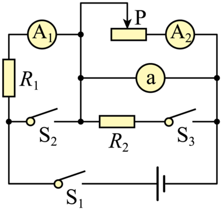

# Physics - 题目 2040

**ID**: 94cbd264760e4c2b8500a6464afdfb9e
**年级**: Grade 9
**难度**: Medium
**题型**: Multiple-choice

## 题目
如图所示，电源电压不变，滑片P置于滑动变阻器中点，a为电流表或电压表。​​​​​​​‌任意开关闭合，电路都是安全的，下列说法正确的是（      ）

## 解答

1. A．由电路图可知，当S_{1}与S_{2}闭合时，电表a与电源串联，若a为电流表，会造成电源短路，故a不是电流表；因此时电路是安全的，说明a是电压表，故A错误；
2. B．只闭合S_{1}，R_{1}和滑动变阻器串联，电压表a测滑动变阻器两端的电压，两电流表测电路中的电流。设P向右滑动前后电路中的电流分别为I_{1}、I_{2}，因串联电路中总电压等于各分电压之和，所以，由欧姆定律可得，电压表a示数的变化量
3. ΔU_{2}=U_{滑}-U_{滑}′=(U-I_{1}R_{1})-(U-I_{2}R_{1})=(I_{2}-I_{1})R_{1}=ΔIR_{1}
4. 则
5. $\frac {{\rm{Δ}}U{{}_{2}}}{{\rm{Δ}}I}=R{{}_{1}}$
6. 即a的示数的变化量与A_{2}示数的变化量的比值不变，故B错误；
7. C．闭合S_{1}、S_{2}，R_{1}短路，A_{1}的示数等于0，电路为变阻器的简单电路，电流表A_{2}测电路的电流（不等于0），故A_{1}的示数不等于A_{2}的示数，故C错误；
8. D．闭合S_{1}、S_{2}、S_{3}时，R_{1}和A_{1}被短路，R_{2}与滑动变阻器并联，A_{2}测变阻器的电流，P向左滑动，变阻器连入电路的电阻变大，由欧姆定律 $I=\frac {U}{R}$ 可知，A_{2}的示数减小，故D正确。
9. 故选D。

## 知识点

**中文**:
  - 动态电路中电表示数的变化

**English**:
  - Changes in Meter Readings in Dynamic Circuits

---
