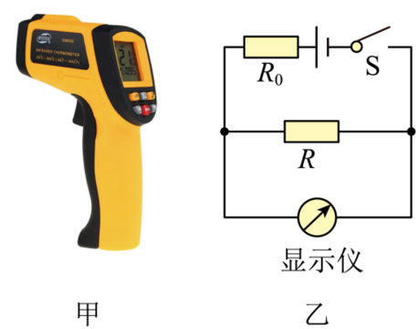

# Physics - 题目 2643

**ID**: a62ffa3c8b5e460782263971ccc8b745
**年级**: Grade 9
**难度**: Medium
**题型**: Multiple-choice

## 题目
常用的某款手持式电子测温仪如图甲，图乙是它工作的原理图，其中电源电压保持不变，R是热敏电阻，用于靠近人体测温，定值电阻R_{0}为保护电阻，显示仪是由电流表或电压表改装而成。​​​​​​​‌在测量人的体温时显示仪的示数会随被测者体温的升高而变大，则下列分析正确的是（      ）

## 解答

1. A．由图可知，热敏电阻R与保护电阻R_{0}串联，显示仪与热敏电阻并联，因此显示仪是由电压表改装的，故A错误；
2. B．电压表测热敏电阻两端电压，由题意可知，在测量人的体温时，显示仪的示数会随被测者体温的升高而变大，说明热敏电阻分得的电压变大，根据串联分压规律可知，热敏电阻的阻值随温度的升高而增大，故B错误；
3. C．被测温者体温越高，热敏电阻的阻值越大，则电路的总电阻变大，根据欧姆定律可知，电路总电流变小，根据P=UI可知，电路的总功率就越小，故C正确；
4. D．将R_{0}更换为阻值更大的电阻，测相同温度，热敏电阻的阻值在更换保护电阻R_{0}前后相同，根据串联分压规律可知，热敏电阻分得的电压变小，显示仪示数变小，故D错误。

## 知识点

**中文**:
  - 动态电路中电表示数的变化

**English**:
  - Changes in Meter Readings in Dynamic Circuits

---
