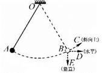

# Physics - 题目 1112

**ID**: a7d31398524e4e07b22532492f234ba8
**年级**: Grade 9
**难度**: Medium
**题型**: Multiple-choice

## 题目
如图所示，在竖直平面内用轻质细线悬挂一个小球，将小球拉至A点，使细线处于拉直状态，由静止开始释放小球，不计摩擦，小球可在A、B两点间来回摆动；​​​​​​​‌当小球摆到B点时，细线恰好断开，则小球将（      ）

## 解答

1. 由于小球被静止释放，不计摩擦，它可在A、B两点间来回摆动；当小球摆到B点时，小球速度恰好为零，此时若细线恰好断开，则小球只受重力作用而竖直下落，所以，将沿BE方向运动。
2. 故选B。

## 知识点

**中文**:
  - 力与运动的关系

**English**:
  - Relationship between Force and Motion

---
