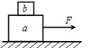

# Physics - 题目 524

**ID**: aaaf9011781249acadbcf3b936727fb0
**年级**: Grade 9
**难度**: Medium
**题型**: Multiple-choice

## 题目
如图所示，木块a放在粗糙水平桌面上，木块b放在木块a上面，在水平拉力F作用下一起向右做匀速直线运动，空气阻力不计，下列判断正确的是​​​​​​​‌

## 解答

1. A．物体a在水平方向只受到拉力和摩擦力，匀速运动时受力平衡，所以拉力F与a受到的摩擦力是相等的，故A错；
2. BD．由于b做匀速直线运动，所以在水平方向上不受力，是在惯性作用下运动的，故B正确，D错；
3. C．a受到的重力小于地面对a的支持力，由于物体b也是压在a上的，故C错；
4. 故应选B。

## 知识点

**中文**:
  - 二力及多力平衡的判断和应用

**English**:
  - Judgment and Application of Equilibrium of Forces

---
