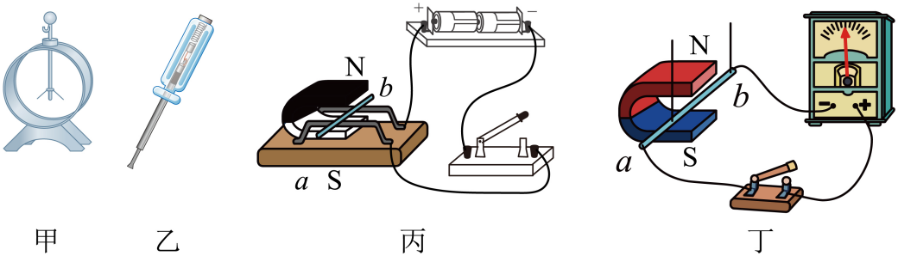

# Physics - 题目 2198

**ID**: c1f6fe7fac31429ab9e6af588f4d0273
**年级**: Grade 9
**难度**: Medium
**题型**: Multiple-choice

## 题目
如题图所示，对于相关器材及物理现象的认识，下列说法正确的是（      ）​​​​​​​‌

## 解答

1. A．图中装置是验电器，原理是同种电荷相互排斥，故A错误；
2. B．使用测电笔时，人体必需接触笔尾金属体构成通路氖管才能发光，故B错误；
3. C．图中装置有电源，说明的是通电导体在磁场中受到力的作用，是电动机的原理，故C正确；
4. D．图中装置没有电源，是电磁感应原理图，由法拉第首次发现，与发电机的原理相同，故D错误。

## 知识点

**中文**:
  - 测电笔的结构和使用
  - 验电器的原理及使用
  - 磁场对通电导线的作用
  - 电磁感应现象

**English**:
  - Structure and Use of Test Pen
  - Principle and Use of Electroscope
  - Effect of Magnetic Field on Energized Wire
  - Electromagnetic Induction

---
