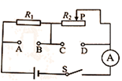

# Physics - 题目 1054

**ID**: c96797fc3bc04cc4b03d8416d8646d4a
**年级**: Grade 9
**难度**: Medium
**题型**: Multiple-choice

## 题目
在图所示的电路中，电源电压保持不变，电压表V可能接在电路的AB或CD两点间。​​​​​​​‌现闭合开关S。在滑动变阻器R_{2}滑片P向右端移动的过程中，电压表示数与电流表示数的比值（      ）

## 解答

1. 电压表V接在电路的AB或CD两点间，分别测R_{1}，R_{2}两端电压，电压表示数与电流表示数的比值，分为R_{1}，R_{2}的电阻值，当滑动变阻器R_{2}滑片P向右端移动的过程中，R_{1}电阻不变，R_{2}的电阻值增大，因此电压表示数与电流表示数的比值可能不变，可能增大。
2. 故选D。

## 知识点

**中文**:
  - 动态电路中电表示数的变化
  - 欧姆定律的应用

**English**:
  - Changes in Meter Readings in Dynamic Circuits
  - Applications of Ohm's Law

---
