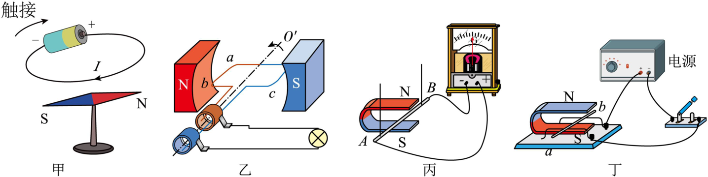

# Physics - 题目 1513

**ID**: c9e2517975bf431c8cb0b24ec6c32593
**年级**: Grade 9
**难度**: Medium
**题型**: Multiple-choice

## 题目
如图所示，是关于电磁现象的实验装置图，下列分析中正确的是（      ）​​​​​​​‌

## 解答

1. A．图甲是奥斯特实验装置，是研究电流的周围存在磁场的实验，故A错误；
2. B．图乙装置中，无电源，是发电机的结构原理图，故B正确；
3. C．图丙装置是研究电磁感应现象，故C错误；
4. D．图丁装置中有电源，是探究通电导体在磁场中受到力的作用，故D错误。
5. 故选B。

## 知识点

**中文**:
  - 探究电磁感应现象的实验
  - 直流电动机的原理
  - 电流的磁效应

**English**:
  - Experiment: Electromagnetic Induction
  - Principle of DC Motor
  - Magnetic Effect of Current

---
