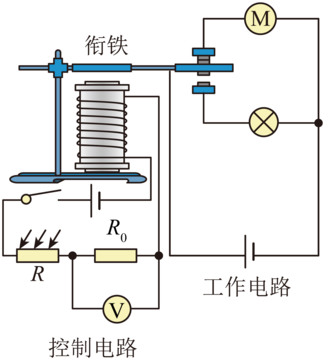

# Physics - 题目 2069

**ID**: cc96cf33b14e46e497e9f21db73d9d1f
**年级**: Grade 9
**难度**: Medium
**题型**: Multiple-choice

## 题目
如图所示为某智能扫地机器人的部分工作原理图。​​​​​​​‌当地面灰尘多时，照射到光敏电阻R的光照强度较小，机器人启动清扫，通过电动机旋转产生高速气流将灰尘等吸入集尘盒。下列说法正确的是（      ）

## 解答

1. A．在控制电路中，电流从电磁铁的上端流入，下端流出，根据安培定则可判断电磁铁上端为N极，下端为S极，故A错误；
2. B．电磁铁是利用电流的磁效应制成的，当电磁铁通电时，周围会产生磁场。磁感线是为了形象地描述磁场分布情况而引入的假想曲线，并不是真实存在的，所以不能说电磁铁周围有磁感线，故B错误；
3. C．衔铁是铁类物质，铁类物质在磁场中会被磁化，从而具有磁性。 当电磁铁通电时，周围会产生磁场，衔铁会被磁化，相当于一个磁体，根据磁体间的相互作用规律，通电后的电磁铁会对衔铁产生磁力，故C错误；
4. D．由题意可知，控制电路中，光敏电阻R和定值电阻R_{0}串联。当地面灰尘多时，照射到光敏电阻R的光照强度较小，此时机器人启动清扫，说明此时工作中电动机电路接通。动触点与上面的静触点接通，此时电磁铁磁性弱，电路中电流小，说明光敏电阻的阻值随光照强度的减小而增大。则当地面灰尘减少时，照射到光敏电阻R的光照强度增大，光敏电阻的阻值会变小。 在控制电路中，电源电压不变，根据串联电路电阻的特点，此时电路中的总电阻变小。 根据欧姆定律可知，电路中的电流会变小。 因为电磁铁的磁性强弱与电流大小有关，电流越大，电磁铁的磁性越强，所以此时电磁铁的磁性会增强，故D正确。

## 知识点

**中文**:
  - 电磁继电器的构造及原理

**English**:
  - Structure and Principle of Electromagnetic Relays

---
