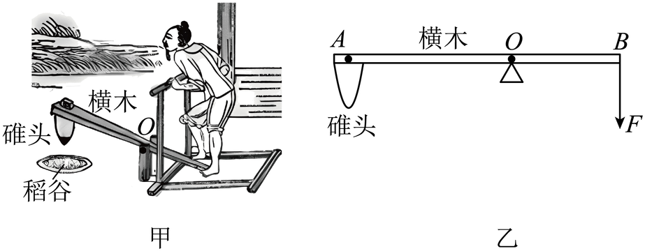

# Physics - 题目 2065

**ID**: d24c2df68a1c4f62812dfd746d4e4dfa
**年级**: Grade 9
**难度**: Medium
**题型**: Multiple-choice

## 题目
如图甲所示，我国古代科技著作《天工开物》中记载了用踏碓给稻谷去壳的过程，用脚连续踩横木的一端，另一端的碓头就会连续起落。​​​​​​​‌其简化原理图如图乙所示，F为捣谷人竖直向下踩横木的力。下列说法正确的是（      ）

## 解答

1. A．脚踏碓在应用中，如图乙，动力臂小于阻力臂，属于费力杠杆，故A错误；
2. B．碓头被抬至最高处时重力势能最大，故B错误；
3. C．捣谷过程中，F的作用点离O越远，动力臂越大，越省力，故C错误；
4. D．根据杠杆的平衡条件知，碓头质量越大，脚在同一位置踩动横木所需的力F越大，故D正确。

## 知识点

**中文**:
  - 动能的影响因素
  - 杠杆平衡条件的应用
  - 杠杆的分类

**English**:
  - Factors Affecting Kinetic Energy
  - Application of Lever Equilibrium Conditions
  - Classification of Levers

---
