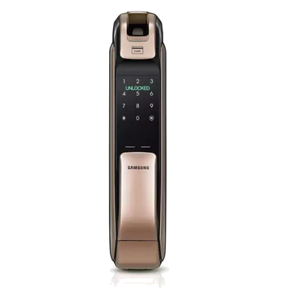

# Physics - 题目 2208

**ID**: d2f1ddf605f147d5a17b5499cce5b1f1
**年级**: Grade 9
**难度**: Medium
**题型**: Multiple-choice

## 题目
智能锁正在逐步走进千家万户。​​​​​​​‌如图所示为某款智能锁，它支持密码与指纹两种认证方式开门，密码正确相当于开关S_{1}闭合，指纹正确相当于开关S_{2}闭合，开门由电动机完成。下列符合该智能锁电路设计的是（      ）

## 解答

1. 根据题意，密码开关和指纹开关并联，均能打开锁，因此电动机在干路中。故B符合题意，ACD不符合题意。

## 知识点

**中文**:
  - 电路图设计

**English**:
  - Circuit Design

---
