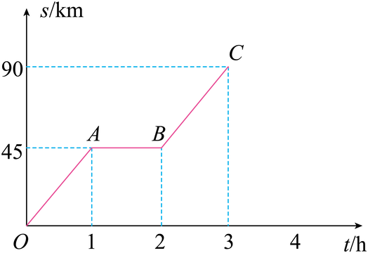

# Physics - 题目 2541

**ID**: d44e0565c0694492b83956e73f776b8e
**年级**: Grade 9
**难度**: Medium
**题型**: Multiple-choice

## 题目
如图是一辆汽车做直线运动的路程一时间（s—t）图像，对线段OA、AB、BC、OC所表示的运动，下列说法正确的是（      ）​​​​​​​‌

## 解答

1. A．OA段汽车通过的路程与时间成正比，表示汽车在做匀速直线运动，故A错误；
2. B．AB段汽车的路程没有发生变化，表示汽车保持静止，故B错误；
3. C．BC段汽车的平均速度为
4. $v{{}_{{\rm{B}}{\rm{C}}}}=\frac {s{{}_{{\rm{B}}{\rm{C}}}}}{t{{}_{{\rm{B}}{\rm{C}}}}}=\frac {{\rm{9}}{\rm{0}}{\rm{k}}{\rm{m}}{\rm{-}}{\rm{4}}{\rm{5}}{\rm{k}}{\rm{m}}}{{\rm{3}}{\rm{h}}{\rm{-}}{\rm{2}}{\rm{h}}}{\rm{=}}{\rm{4}}{\rm{5}}{\rm{k}}{\rm{m}}{\rm{/}}{\rm{h}}$
5. 故C正确；
6. D．OC段的平均速度为
7. $v{{}_{{\rm{O}}{\rm{C}}}}=\frac {s{{}_{{\rm{O}}{\rm{C}}}}}{t{{}_{{\rm{O}}{\rm{C}}}}}=\frac {{\rm{9}}{\rm{0}}{\rm{k}}{\rm{m}}}{{\rm{3}}{\rm{h}}}{\rm{=}}{\rm{3}}{\rm{0}}{\rm{k}}{\rm{m}}{\rm{/}}{\rm{h}}$
8. 故D错误。
9. 故选C。

## 知识点

**中文**:
  - 平均速度及其计算
  - 速度的图像问题

**English**:
  - Average Velocity and Calculation
  - Velocity-Time Graphs

---
