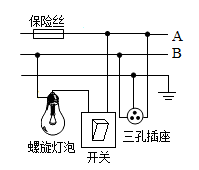

# Physics - 题目 2467

**ID**: d5c2cacb1ceb4f829cf1d5abe9cb221b
**年级**: Grade 9
**难度**: Medium
**题型**: Multiple-choice

## 题目
如图是家庭电路正常工作的一部分。​​​​​​​‌下列说法中正确的是（      ）

## 解答

1. A．由图可知，保险丝安装在火线上，A是火线，B是零线，零线B与大地之间的电压为0V，故A错误；
2. B．保险丝的材料是电阻率较大而熔点较低的铅锑合金，在电流过大时熔断，自动切断电路，起到保护作用；铁丝的熔点很高，当电流过大时，不能熔断起不到保护作用，容易引起火灾，故B错误；
3. C．三孔插座已接地，当电冰箱的插头插入三孔插座能使电冰箱的金属外壳接地，这样能防止金属外壳的用电器漏电发生触电事故，故C正确；
4. D．插座的左孔接零线，右孔接火线，所以测电笔插入插座的左氖管不发光，插入插座的右插孔氖管发光，故D错误。
5. 故选C。

## 知识点

**中文**:
  - 家庭电路工作电压、零线火线
  - 熔断器的作用及保险丝的选择
  - 插座和插头的接线及作用

**English**:
  - Working Voltage, Neutral and Live Wires
  - Fuses and their Selection
  - Wiring and Function of Sockets and Plugs

---
