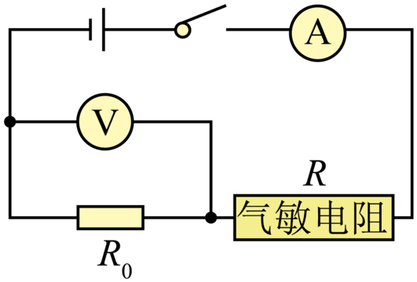

# Physics - 题目 1926

**ID**: d6f0368e789f48f78507f8d5ea6007af
**年级**: Grade 9
**难度**: Medium
**题型**: Multiple-choice

## 题目
酒精测试仪可检测驾驶员是否酒后驾车，下图是它的原理图。​​​​​​​‌电源电压恒定，R_{0}是定值电阻，R是气敏电阻，它的阻值随着酒精气体的浓度增大而减少，如果测试到酒精气体浓度增大，则下列说法正确的是（      ）

## 解答

1. ABC．由图得，R_{0}与R串联，电压表测量R_{0}电压，电流表测量电路电流，当酒精气体浓度增大，R阻值减少，电路中总电阻减小，电路中电流增大，即电流表示数变大，由欧姆定律得，R_{0}电压变大，即电压表示数变大，故AB错误，C正确；
2. D．电压表示数与电流表示数的比值为定值电阻R_{0}阻值，保持不变，故D错误。

## 知识点

**中文**:
  - 动态电路中电表示数的变化

**English**:
  - Changes in Meter Readings in Dynamic Circuits

---
