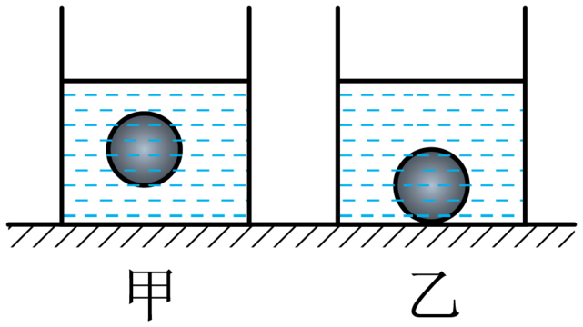

# Physics - 题目 1531

**ID**: d90a10a345cb419594a080455368adba
**年级**: Grade 9
**难度**: Medium
**题型**: Multiple-choice

## 题目
如图所示，水平桌面上两只相同的烧杯中分别盛有甲、乙两种不同液体，两个相同的小球在液体中静止时，两烧杯液面相平，则（      ）​​​​​​​‌

## 解答

1. AC．甲液体中的小球处于悬浮，则受到的浮力等于小球的重力，乙液体中的小球下沉在容器的底部，则受到的浮力小于小球的重力，由于两个小球是相同的，则小球的重力相等，所以，甲液体中的小球所受浮力大，故A正确，C错误；
2. B．小球在甲液体中悬浮，甲液体的密度等于小球的密度，小球在乙液体中沉底，乙液体的密度小于小球的密度，由于两个小球是相同的，所以甲液体的密度大于乙液体的密度，由图可知两液体的深度相同，根据p=ρgh可知，甲液体对烧杯底部的压强大，故B错误；
3. D．由图可知两只相同的烧杯中液体的深度相同，小球排开的体积相同，则甲乙液体的体积相等，且甲液体的密度大于乙液体的密度，根据 $ρ=\frac {m}{V}$ 知，甲液体的质量大于乙液体的质量，又因为两小球的质量和两烧杯的质量都相同，根据G=mg知，甲容器对桌面的压力大于乙容器对桌面的压力，故D错误。

## 知识点

**中文**:
  - 压力大小的比较
  - 液体压强计算公式的应用
  - 物体的浮沉条件及其应用

**English**:
  - Comparing Magnitude of Pressure Force
  - Application of Liquid Pressure Formula
  - Floating/Sinking Conditions and Applications

---
