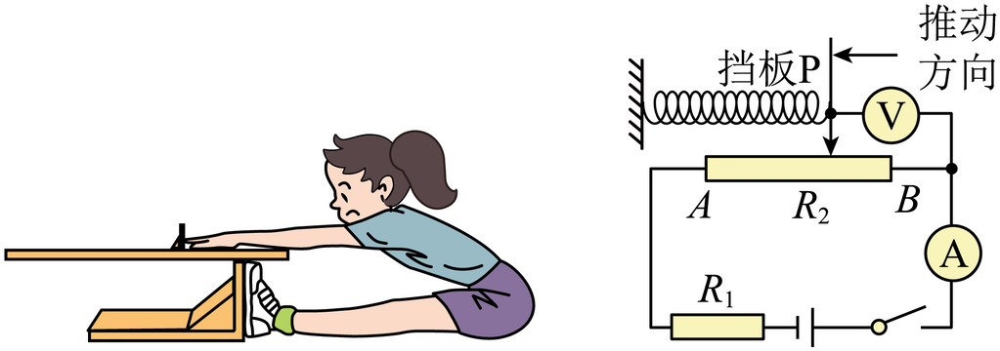

# Physics - 题目 2023

**ID**: e41b962430704928a228ee0c599cb86c
**年级**: Grade 9
**难度**: Medium
**题型**: Multiple-choice

## 题目
“坐位体前屈”是用于反映人体柔韧性的测试项目。​​​​​​​‌在一次综合实践活动中，小林自制了一个坐位体前屈成绩测量仪，原理如图所示，其中电源电压恒为 ${\rm 6V，}R{{}_{1}}=20Ω$ ，电阻丝 $R{{}_{2}}$ 粗细均匀，总长度为20cm。闭合开关，挡板P在B端时，坐位体前屈成绩为0cm，电流表示数为0.1A；挡板P在A端时，坐位体前屈成绩为20cm。下列分析正确的是（      ）

## 解答

1. A．由图可知， $R{{}_{1}}$ 、 $R{{}_{2}}$ 串联，电流表测电路电流，电压表测 $R{{}_{2}}$ 右半部分分得的电压。 $R{{}_{2}}$ 的全部接入电路中，移动推挡板P无法改变电阻丝 $R{{}_{2}}$ 接入的阻值，根据欧姆定律可知，电路中的电流不变，故A错误；
2. B． $R{{}_{1}}$ 电压为
3. $U{{}_{1}}=IR{{}_{1}}=0.1{\rm{A}}\times 20\Omega =2{\rm{V}}$
4. 根据串联电压规律， $R{{}_{2}}$ 的电压为
5. $U{{}_{2}}=U-U{{}_{1}}=6{\rm{V}}-2{\rm{V}}=4{\rm{V}}$
6. 挡板在A端时，电压表测整个 $R{{}_{2}}$ 分得的电压，所以挡板在A端时，电压表的示数为4V，故B正确；
7. C．坐位体前屈的成绩越好， $R{{}_{2}}$ 右半部分阻值越大，根据 $U=IR$ ，电压表的示数越大，故C错误；
8. D．电路中的电流不变，电源电压不变，根据 $P=UI$ 可知电路的总功率不变，故D错误。

## 知识点

**中文**:
  - 欧姆定律的应用
  - 电路的动态分析
  - 电功率的计算及应用

**English**:
  - Applications of Ohm's Law
  - Dynamic Circuit Analysis
  - Calculation and Application of Electric Power

---
