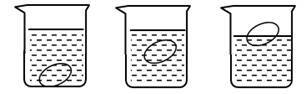

# Physics - 题目 2001

**ID**: e6f6ee8e439748e290c04e9a83356ed2
**年级**: Grade 9
**难度**: Medium
**题型**: Multiple-choice

## 题目
如图所示，索朗不断地在水中加盐，使一个沉在杯底的鸡蛋由沉底逐渐悬浮，最后漂浮在液面上。​​​​​​​‌以下说法正确的是 （      ）

## 解答

1. AB．鸡蛋在第一个图中沉入水底，则
2. F_{浮}_{1}＜G
3. 在第二个图中悬浮，则
4. F_{浮}_{2}=G
5. 在第三个图中漂浮，则
6. F_{浮}_{3}=G
7. 所以鸡蛋沉底时受到的浮力小于悬浮时受到的浮力，故AB错误；
8. CD．鸡蛋悬浮时受到的浮力与漂浮时受到的浮力一样大，故C正确，D错误。
9. 故选C。

## 知识点

**中文**:
  - 物体的浮沉条件及其应用

**English**:
  - Floating/Sinking Conditions and Applications

---
