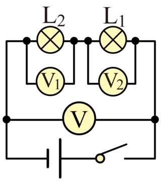

# Physics - 题目 1643

**ID**: f07c07396ab34d5998a49329e8500666
**年级**: Grade 9
**难度**: Medium
**题型**: Multiple-choice

## 题目
如图所示，闭合开关S后，电压表 ${\rm{V}}{{}_{1}}$ 和 ${\rm{V}}{{}_{2}}$ 的示数分别为2.​​​​​​​‌7V和3V，则电压表V的示数是（      ）

## 解答

1. 由题图知，灯泡 ${\rm{L}}{{}_{1}}$ 、灯泡 ${\rm{L}}{{}_{2}}$ 、电源和开关组成串联电路，电压表 ${\rm{V}}{{}_{1}}$ 测量灯泡 ${\rm{L}}{{}_{2}}$ 两端的电压，电压表 ${\rm{V}}{{}_{2}}$ 测量灯泡 ${\rm{L}}{{}_{1}}$ 两端的电压，电压表 ${\rm{V}}$ 测量灯泡 ${\rm{L}}{{}_{1}}$ 、灯泡 ${\rm{L}}{{}_{2}}$ 串联后的电压，由串联电路中电压特点可知电压表V的示数为电压表 ${\rm{V}}{{}_{1}}$ 和 ${\rm{V}}{{}_{2}}$ 的示数之和，即为5.7V，故D符合题意，ABC不符合题意。
2. 故选D。

## 知识点

**中文**:
  - 串联电路的电压规律
  - 电压表的使用

**English**:
  - Voltage Law in Series Circuits
  - Using a Voltmeter

---
