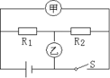

# Physics - 题目 28

**ID**: f5cd32c32b6a4b63b0fc3b484d8cefdf
**年级**: Grade 9
**难度**: Medium
**题型**: Multiple-choice

## 题目
如图所示的电路中，当开关Ｓ闭合，甲、乙两表示为电压表时，示数之比 $U{{}_{甲}}：U{{}_{乙}}{\rm{=}}3:2$ ；​​​​​​​‌当开关S断开，甲、乙两表是电流表时，则两表的 示数之比为 $I{{}_{甲}}：I{{}_{乙}}$ 为（      ）

## 解答

1. 当开关S闭合，甲、乙两表示为电压表时，电路为串联电路，所以
2. $\frac {U{{}_{甲}}}{U{{}_{乙}}}{\rm{=}}\frac {R{{}_{1}}+R{{}_{2}}}{R{{}_{2}}}{\rm{=}}\frac {3}{2}$
3. 解得
4. $\frac {R{{}_{1}}}{R{{}_{2}}}{\rm{=}}\frac {1}{2}$
5. 当开关S断开，甲、乙两表是电流表时，电路为并联电路，所以
6. $\frac {I{{}_{1}}}{I{{}_{2}}}=\frac {R{{}_{2}}}{R{{}_{1}}}{\rm{=}}\frac {2}{1}$
7. $\frac {I{{}_{甲}}}{I{{}_{乙}}}=\frac {I{{}_{2}}}{I{{}_{1}}+I{{}_{2}}}=\frac {1}{2+1}=\frac {1}{3}$
8. 故选D。

## 知识点

**中文**:
  - 欧姆定律的应用

**English**:
  - Applications of Ohm's Law

---
